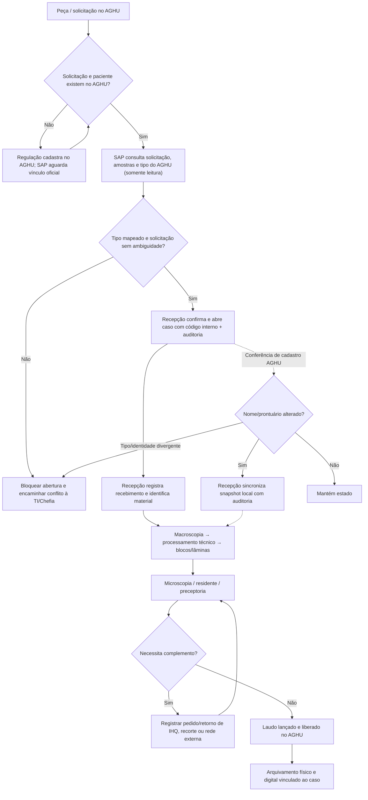

# Refino pós-avaliação — Gestão Digital da Anatomia Patológica (SAP)

**Status:** implementação técnica parcial entregue para revisão; **não homologado para produção**.  
**Referência:** imagem BPMN “Gestão Digital da Anatomia Patológica — Situação hoje” e quatro apontamentos de avaliação.  
**Premissa:** AGHU Slave é a fonte oficial e somente leitura; o SAP mantém exclusivamente workflow e auditoria locais.

## 1. Decisões adotadas

| Apontamento | Decisão de produto | Comportamento implementado |
| --- | --- | --- |
| O que significa cada KPI? | Exibir fonte, população, definição, marco temporal e limites de interpretação. | `GET /api/dashboard/resumo` inclui `criterios`, `prazos_horas_por_tipo`, `prazo_cobertura_casos`. Dashboard usa SQLite real e indica “Não medido” onde não há dados. |
| O SAP deveria criar pacientes? | **Não.** Cadastro e retificação acontecem no AGHU/Regulação, nunca no SAP. | `/pacientes` é consulta. API expõe apenas GET. Escrita no provider PostgreSQL bloqueada, mesmo se o parâmetro legado estiver ligado. CSV permanece apenas como catálogo offline. |
| Tipo de exame vem do AGHU? | **Sim e é imutável na abertura.** Não há seleção pela plataforma. | POST `/api/casos` aceita somente `solicitacao_aghu` e rejeita parâmetros adicionais. Tipo é validado no cabeçalho do AGHU, reconsultado no POST. Sem tipo válido, retorna conflito 409, **sem criar caso**. |
| Atualização do paciente no AGHU? | Tratar como **conciliação cadastral** preservando histórico. | Nova conferência GET e sincronização POST auditada apenas pela Recepção para casos abertos. Conflito de identidade/tipo bloqueia; indisponibilidade do AGHU preserva o snapshot local. |

> **Dependência crítica:** o SQL de solicitação enviado com o projeto NÃO continha o código/tipo do exame. `src/providers/sql/aghu/buscar_solicitacao.sql` expõe temporariamente `NULL AS tipo_exame` de propósito. A equipe DBA/SETISD precisa confirmar as tabelas, codificações e cardinalidade por solicitação; até então **abertura bloqueada em ambiente real**. Não se deve inferir o procedimento pelo nome do paciente, pela amostra ou por seleção manual.

## 2. Matriz de origem de dados e governança

| Dado | Fonte de verdade | Armazenamento/uso no SAP | Editabilidade |
| --- | --- | --- | --- |
| Código, nome, prontuário do paciente | AGHU (`aip_pacientes`, conforme mapeamento) | Código técnico + snapshot cifrado de nome/prontuário ligado ao caso | Somente a origem; atualização local mediante conciliação auditada |
| Solicitação e itens/amostras | AGHU | Identificadores vinculados; sem criação de registro órfão | Não editável |
| Tipo do exame | AGHU, classificado por regra validada pela Chefia/DBA | Uma sigla HP/CO/CG/CCV por caso e seu fluxo derivado | Não editável pelo usuário |
| Etapa, responsável, encaminhamento, retorno | SAP | Movimentações locais imutáveis e status | Segundo RBAC/fluxo |
| Material: peça, cassete, bloco, lâmina | SAP vinculado ao AGHU | **Lacuna do sistema atual:** ainda faltam entidades/etiquetas detalhadas | A projetar |
| Evento de chegada/recebimento físico | Protocolo/Recepção e SAP | **Lacuna:** não há timestamp próprio para recebimento | A instrumentar |
| Data de liberação do laudo | AGHU | **Lacuna:** não capturada pelo SAP atual | Nunca editar o AGHU |
| Prazos de referência | Chefia da UACAP | Configuração de implantação `SAP_PRAZOS_EXAME_HORAS` | Somente mudança aprovada, com controle de versão |

### Exames com múltiplos itens

A unidade de trabalho atualmente é **uma solicitação = um caso** (RF004). Antes de mapear `tipo_exame` no SQL, validar se uma solicitação no AGHU pode reunir itens de tipos diferentes. Em caso positivo, decidir formalmente se o SAP passa a usar **solicitação + item** como chave composta ou se a origem já fornece solicitação segregada por tipo. Não escolher o primeiro exame silenciosamente; rejeitar ambiguidades e preservar rastreabilidade.

### Cadastro de pacientes externos

O BPMN menciona peça oriunda do SUS ou HC e o documento de negócio prevê fluxo da Regulação quando ainda não há cadastro. **Não criar paciente provisório no AGHU pelo SAP.** Registrar futuramente *pendência de Regulação sem caso clínico ativo*, com identificador externo e acesso restrito, e abrir o caso apenas após existir uma solicitação oficial. Esse fluxo não está implementado nesta entrega e precisa de regra de retenção LGPD.

## 3. Dicionário do dashboard — contrato desta entrega

| Indicador | Fórmula / período / corte | Nesta versão |
| --- | --- | --- |
| **Total de casos** | `COUNT` de casos `ativo=1` cadastrados desde início do SAP, qualquer status. | Real |
| **Casos pendentes** | Casos ativos cujo `status != ARQUIVADO`, todas as etapas. | Real; **não** significa inconformidade |
| **Casos atrasados** | Pendentes cujo `(agora UTC - casos.criado_em) > prazo_horas[tipo]`, em **horas corridas**. | Real apenas quando há prazo configurado **para todos os pendentes** e timestamps válidos; senão `null`. |
| **Aguardando complementação** | Futuramente: pendências estruturadas de IHQ/revisão/rede externa em aberto. | `null` — inexiste um evento confiável de pedido/retorno. |
| **Tempo médio de liberação** | Futuramente: `AVG(data_hora_liberacao_laudo_aghu - data_hora_recebimento_amostra)` em horas; definir elegibilidade por exame/período. | `null`: sem os dois timestamps necessários. |
| **Cumprimento de prazo** | Futuramente: `100 × laudos liberados dentro do SLA / laudos liberados elegíveis` por período/tipo, com política de pausas. | `null`; **não** calcular a partir de arquivamentos. |
| **Automação de dados** | Futuramente: `100 × campos obtidos automaticamente da origem / campos elegíveis de integração` com eventos mensurados. | `null`. |
| **Rastreabilidade** | Futuramente: `100 × casos com cadeia mínima de eventos peça→bloco→lâmina→laudo / casos elegíveis`. | `null`. |
| **Inconsistências** | `COUNT` de `caso_inconformidades.situacao = 'ABERTA'` associadas a casos ativos. | Real; exibe inconformidades **abertas**, não qualquer erro. |
| **Rejeições** | Futuramente: número de materiais formalmente rejeitados segundo causa, registro e período. | `null`. |
| **Erros de transcrição** | Futuramente: número de divergências verificadas e classificadas como transcrição. | `null`. |

**Convenções:** `0` = zero eventos conhecidos; `null` = não medido / não configurado. A data “Atualizado em” é a da consulta ao painel, **não** a da sincronização do AGHU. A fonte é `banco_dados` para dados locais reais e `demonstracao` somente no provedor de demonstração, que não é mais o padrão da API.

**SLA de exemplo não é SLA clínico.** Nenhum prazo foi inventado. No `.env`, `SAP_PRAZOS_EXAME_HORAS={}` por padrão. Quando a Chefia aprovar valores e o evento inicial, preencher JSON como `{"HP": 120, "CO": 3}` **apenas se esses números forem formalmente aprovados**; os números deste exemplo ilustram somente a sintaxe e não constituem recomendação de prazo.

**Decisões pendentes obrigatórias:** (a) data inicial: recebimento físico, aceite da solicitação ou abertura do caso? (b) horas corridas ou úteis e feriados? (c) quais pausas contam, como IHQ/rede externa/pendência do solicitante? (d) exame de Congelação precisa SLA específico em minutos? (e) denominador e período dos casos? (f) como medir reemissão/correção de laudo e solicitações canceladas? (g) responsabilidade por aprovar/alterar prazos?

> Enquanto o marco temporal homologado não for abertura do caso, o indicador “Casos atrasados” é **apenas operacional** e não uma medida oficial de prazo do laboratório.

## 4. Regra de conciliação AGHU ↔ SAP

1. Ao receber solicitação, o SAP consulta o AGHU e abre caso somente quando há paciente, amostras, tipo válido e fluxo.
2. Dados cadastrais ficam cifrados no snapshot local para permitir consulta mesmo se AGHU estiver temporariamente indisponível.
3. Na tela do caso, `GET /api/casos/{id}/conferencia-aghu` reconsulta o AGHU e compara **nome e prontuário**; exibe diferenças apenas ao perfil autorizado de **Recepção**.
4. Se mudou somente nome/prontuário e o caso está aberto, a **Recepção** pode chamar `POST /api/casos/{id}/sincronizar-aghu`. O servidor **reconsulta** a origem, atualiza campos cifrados e índice HMAC, anexa movimentação `SINCRONIZACAO_AGHU` e grava auditoria antes/depois cifrada **na mesma transação**.
5. Se mudou `paciente_codigo_aghu` ou `tipo_exame`, retorna `409`: não migrar o caso, o número interno, a etapa ou as amostras sem investigação humana. A identidade do caso é clínica e histórica.
6. Se o caso está **arquivado**, é possível conferir, mas não sincronizar automaticamente. Corrigir a origem e encaminhar análise formal para retificação/histórico do caso.
7. Se o AGHU não responde, retorna `503` e **não altera** o caso. O indicador na UI deve refletir que não houve conferência.
8. Atualizações de histórico, exame, amostras, cancelamento e paciente mesclado/desmembrado são **reconciliações distintas, ainda não implementadas**.

**Frequência:** conferência manual sob demanda nesta versão. Evolução recomendada: job de reconciliação somente leitura por solicitações ativas, com cursor/última alteração se o AGHU fornecer, alertas e filas de conflito; sem sobrescrever silenciosamente dados ou laudos.

## 5. BPMN desejado (visão funcional simplificada)



**Nota:** o desenho representa o fluxo-alvo e não atesta implantação das etapas de materiais/relatórios indicadas abaixo. Os participantes reais — Recepção, Macroscopia, Processamento Técnico, Microscopia/Preceptoria, TI e AGHU — devem ser desenhados como raias no BPMN final validado pela unidade.

## 6. Escopo implementado versus lacunas do projeto completo

| Prioridade | Entrega | Situação |
| --- | --- | --- |
| P0 | Fonte AGHU soberana para cadastro e tipo, API sem CRUD cadastral, auditar reconciliação | **Código entregue**, depende do SQL do tipo homologado |
| P0 | Banco local por caso, amostras, etapa e histórico/auditoria | Existente e preservado |
| P0 | Dashboard com definições, cobertura do SLA e `null` explícito | **Código entregue** |
| P0 | Homologação SQL do AGHU, permissões SELECT, cardinalidade da solicitação, qualidade dos dados | **Pendente de DBA/SETISD** |
| P0 | Proteção de dados, política de retenção, acessos por unidade, LGPD/segurança em produção | **Revisão institucional pendente** |
| P1 | Registro estruturado de recebimento da amostra com data/hora, operador e etiqueta/código de barras | Não implementado |
| P1 | Peças/cassetes/blocos/lâminas com identificadores, arquivo físico e transferência de custódia | Não implementado |
| P1 | Evento confiável de laudo liberado no AGHU; cálculo real de turnaround / % no prazo | Não implementado |
| P1 | Gestão estruturada de complementações, IHQ e retornos com prazos e motivo | Parcial (encaminhamento genérico já existe); falta domínio clínico |
| P1 | Tela de chefia para homologar prazos, vigência/versão e calendário de expediente | Prazos via config, sem UI |
| P2 | Relatórios por etapa, período e tipo; controle de rejeição / divergência / automação | Não implementado |
| P2 | Conciliação periódica automática por eventos AGHU, alertas e fila de conflitos | Não implementado |
| P2 | Fluxos completos para Congelação, CG/CCV, IHQ externa e Regulação | Conforme decisão/validação da unidade, não integral nesta entrega |

## 7. Critérios de aceite para homologação

- [x] API não contém POST/PUT/DELETE em `/api/pacientes`; consulta exige autenticação.
- [x] `POST /api/casos` rejeita `tipo_exame` enviado pelo cliente; abertura só com código/solicitação oficial.
- [x] Tipo ausente/não mapeado retorna 409; nenhuma persistência local em erro de AGHU.
- [x] Sincronização de nome/prontuário com auditoria, sem edição AGHU, permissões e preservação de histórico.
- [x] Chaves clínicas alteradas bloqueiam atualização automática (409).
- [x] Dashboard real distingue `0` e `null`; definições de todos os KPIs constam na UI.
- [x] `pytest -q` em ambiente offline, `npm run build` e auditoria de arquitetura executados.
- [ ] DBA homologa SQL de tipo e amostras e garante retorno consistente por tipo/solicitação.
- [ ] Chefia aprova marco e duração por exame; documentar horário útil/feriados/suspensões.
- [ ] Teste integrado do **AGHU Slave real** com dados autorizados e identidade LGPD.
- [ ] Migração Alembic verificada em cópia/backup real; plano de rollback e recuperação.
- [ ] Homologação funcional do BPMN completo com perfis de cada raia.
- [ ] Avaliação de pen-test, auditoria clínica, logging/observabilidade e gestão de incidentes.

## 8. Instalação, migração e testes

```bash
# Em ambiente com variáveis de segurança configuradas e banco previamente respaldado:
alembic upgrade head
python -m pytest -q
python audit_framework.py .
cd frontend && npm ci && npm run build
```

A migração `20261110_refino_aghu` adiciona `casos.ultima_sincronizacao_aghu` (nullable). Instalações existentes têm `NULL` até a primeira alteração posterior. Sem migração em produção, **a abertura/detalhe/sincronização podem falhar**, pois SQL e ORM esperam a nova coluna.

**Rotas principais:**
- `GET /api/pacientes`, `GET /api/pacientes/{codigo}` e `/capacidades` — apenas leitura;
- `GET /api/casos/aghu/solicitacao/{numero}` — visualização AGHU e tipo ainda não autorizado, quando ausente;
- `POST /api/casos` — `{ "solicitacao_aghu": "123" }`;
- `GET /api/casos/{id}/conferencia-aghu` — compara dados;
- `POST /api/casos/{id}/sincronizar-aghu` — Recepção; audita as diferenças;
- `GET /api/dashboard/resumo` — agregados reais e critérios.

## 9. Decisões que precisam de aceite formal da Chefia/SETISD

1. Mapeamento de tipo HP/CO/CG/CCV a partir do AGHU, incluindo conflitos/solicitações com mais de um item ou IHQ.
2. SLA por tipo e evento de início/fim, úteis ou corridos, pausas e casos suspensos.
3. Quais dados do paciente podem ser expostos por papel; rotina de correções, nome social, merge e histórico de laudos.
4. Responsável por receber/validar materiais e emitir eventos para blocos, cassetes, lâminas e arquivos.
5. Critério de “complementação”, “inconformidade”, “rejeição”, “erro” e “automação” para cada indicador.
6. Integração com AGHU autorizada, com read replica, limites de consulta e monitoramento de falhas.

### Risco/limite conhecido

Não houve acesso ao AGHU real, à equipe de validação clínica ou ao banco de produção. **Os testes são locais e usam o AGHU simulado**. A atualização de cadastro é sob demanda, não automática. A aplicação está tecnicamente refatorada para homologação, mas não é recomendada para liberação clínica até que as pendências P0 sejam resolvidas.
