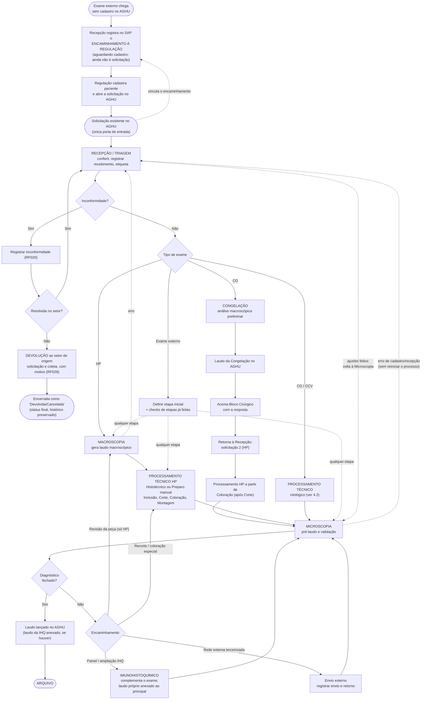
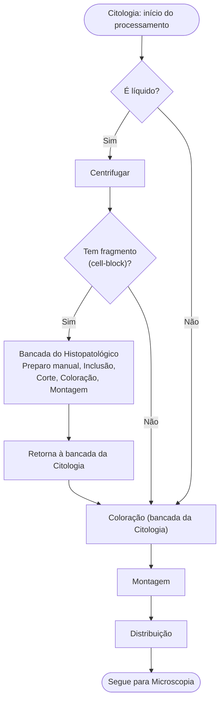

# Especificação de Requisitos

> **Sistema:** Serviço de Anatomia Patológica (SAP) — HC-UFPE / SETISD
> **Origem:** `00-validacao-negocio.md` (regras RN-01 a RN-07, atores, pontos de decisão), `01-visao.md` (escopo e objetivos OBJ-01 a OBJ-07) e o *Feedback do fluxo atual do processo*.
> **Escopo de exames:** Histopatológico (HP), Congelação (CO), Imunohistoquímico (IHQ), Citologia Geral (CG) e Cérvico-vaginal (CCV).
> **Termo de trabalho:** a unidade acompanhada pelo SAP é a **solicitação de exame** do AGHU. O SAP não cria um conceito próprio ("caso") para ela.

## 1. Requisitos Funcionais (RF)

| ID | Título | Descrição | Prioridade |
| :--- | :--- | :--- | :---: |
| RF001 | Autenticação | Login via LDAP/AD do hospital. | Essencial |
| RF002 | Controle de acesso por perfil | Perfis Recepção, Laboratório/Técnicos, Residentes, Validação/Preceptoria e Técnico Administrativo (Chefia do UACAP), cada um com permissões próprias; nenhum perfil altera dados de setores fora da sua alçada, e nenhum perfil altera dados vindos do AGHU. | Essencial |
| RF003 | Dados do AGHU (leitura e imutabilidade) | Consultar o AGHU Slave e preencher automaticamente os dados de paciente, solicitação e amostra, sem redigitação e sem cópia manual divergente. Os dados vindos do AGHU são exibidos sempre como somente leitura: nenhum perfil pode editá-los no SAP. Correções são feitas no próprio AGHU e passam a aparecer no SAP. | Essencial |
| RF004 | Abertura da solicitação de exame e vínculo | Abrir no SAP apenas solicitações de exame que já existem no AGHU, a partir do número da solicitação. Não existe criação manual de solicitação nem digitação dos dados primários (paciente, solicitação, amostra): eles vêm exclusivamente do AGHU. As amostras ficam sempre vinculadas à solicitação e aos identificadores de origem. Não permite registro órfão. | Essencial |
| RF005 | Fluxo por tipo de exame | Manter a definição de etapas e transições permitidas para cada tipo de exame (HP, CO, IHQ, CG, CCV), de forma configurável. | Essencial |
| RF006 | Recepção e conferência | Registrar o recebimento da amostra (data, hora e profissional), revisar o cadastro e gerar a etiqueta com o identificador interno (`SIGLA-NNNN/AA`, ex.: `HP-0001/26`, numeração própria de cada sigla, reiniciada a cada ano). O protocolo físico assinado continua existindo, a pedido do setor. | Essencial |
| RF007 | Pacientes externos: encaminhamento à Regulação | Registrar o encaminhamento dos dados do exame externo à Regulação (dados enviados, data e responsável), numa lista de "aguardando cadastro". O encaminhamento não é uma solicitação de exame: não recebe identificador interno nem pode ser processado. Quando a Regulação cadastra o paciente e abre a solicitação no AGHU, a Recepção abre a solicitação no SAP (RF004) e vincula o encaminhamento a ela, que sai da lista. | Importante |
| RF008 | Macroscopia | Registrar a macroscopia e gerar o laudo macroscópico, que é emitido ao final da etapa e independe do laudo final. | Essencial |
| RF009 | Congelação | Registrar o ciclo reduzido da Congelação (incluindo a análise macroscópica preliminar), o laudo da Congelação e o aviso ao Bloco Cirúrgico. Ao fim, o material volta à Recepção, que recebe no AGHU a solicitação seguinte (HP). Congelação e HP são duas solicitações de exame, acompanhadas separadamente. | Importante |
| RF010 | Processamento técnico (HP) | Registrar início por Histotécnico ou Preparo manual, inclusão, corte, coloração e montagem. | Essencial |
| RF011 | Processamento técnico citológico (CG/CCV) | Registrar o fluxo condicional: material líquido (centrifugação), presença de fragmento (cell-block, que passa pela bancada do HP e retorna na Coloração) e coloração, montagem e distribuição. | Importante |
| RF012 | Material derivado | Registrar peças, cassetes, blocos e lâminas, todos rastreáveis até a solicitação de exame de origem, com etapa atual consultável. | Essencial |
| RF013 | Microscopia e pré-laudo | Permitir que Residentes preencham o pré-laudo em tela única após a análise da peça e o enviem à Preceptoria. | Essencial |
| RF014 | Validação, laudo e arquivo | Preceptoria revisa o pré-laudo, registra o diagnóstico e a confirmação do lançamento do laudo no AGHU (com o laudo da IHQ anexado apenas quando houve IHQ solicitada) e conclui o arquivamento da solicitação de exame. | Essencial |
| RF015 | Encaminhamentos e retornos | Permitir ao responsável pela etapa encaminhar ou retornar a solicitação de exame entre etapas (ex.: Macroscopia ou Microscopia para Recepção; Microscopia para Macroscopia, Processamento Técnico ou IHQ), com motivo obrigatório, sem reiniciar o processo e sem perder o histórico. | Essencial |
| RF016 | Processamentos adicionais e IHQ | Permitir pedir recorte, coloração especial, revisão da peça e painel ou ampliação de IHQ, sempre vinculados à solicitação de exame original. A IHQ complementa o exame em curso e gera um laudo próprio, que é anexado ao laudo principal. | Essencial |
| RF017 | Encaminhamento externo | Registrar envio, finalidade, situação e retorno de material enviado à rede externa terceirizada ou ao hospital conveniado (IHQ), com alerta de material não retornado. | Importante |
| RF018 | Exames externos | Para exames externos já cadastrados no AGHU (RF007), permitir indicar a etapa inicial após o recebimento e marcar (check) etapas já realizadas fora do HC. | Importante |
| RF019 | Progressão controlada e status | Só concluir etapa com campos obrigatórios preenchidos; derivar o status da solicitação de exame das etapas registradas, impedindo "concluída/liberada/arquivada" com pendências. Há dois encerramentos possíveis: com laudo ("Concluída") ou por devolução ("Devolvida"/"Cancelada", RF029). | Essencial |
| RF020 | Inconformidades e rejeições | Registrar divergências, ausência de informação e condicionamento inadequado, com motivo, situação e resolução vinculados à solicitação de exame. | Essencial |
| RF021 | Histórico de movimentações | Registrar e exibir, por solicitação de exame, cada movimentação (etapa, data/hora, responsável) e cada alteração com valor anterior e novo. | Essencial |
| RF022 | Correção após laudo liberado | Reabertura formal de solicitação de exame ou laudo concluído, com justificativa obrigatória, laudo anterior preservado e permissão restrita. Regra exata depende do ponto de decisão 5. | Importante |
| RF023 | Painel de pendências e prazos | Painel em tempo real de solicitações pendentes, atrasadas ou aguardando complemento, e de encaminhamentos à Regulação aguardando cadastro, por etapa e por responsável (inclusive quantas aguardam cada preceptor/patologista), com alertas conforme prazos de referência (ponto de decisão 2). | Importante |
| RF024 | Indicadores gerenciais | Exibir turnaround time, taxa de cumprimento de prazos, volume de solicitações, rejeições, devoluções, automação do preenchimento e rastreabilidade. | Importante |
| RF025 | Procedimentos faturáveis | Registrar de forma estruturada os procedimentos definidos como faturáveis (lista do ponto de decisão 8) e permitir sua consulta consolidada. | Importante |
| RF026 | Substituição na ausência | Permitir delegar temporariamente validação e permissões da Preceptoria ou Chefia a substitutos, com registro da delegação. | Desejável |
| RF027 | Busca de solicitações de exame | Localizar solicitações por número da solicitação do AGHU (código do exame), prontuário do paciente, identificador interno, tipo de exame, etapa ou status. O nome do paciente fica cifrado e não é critério de busca. | Importante |
| RF028 | Gestão de usuários e perfis | A Chefia inclui no SAP um login de rede existente no AD (o nome vem do AD), escolhe o perfil, altera o perfil e inativa ou reativa o acesso. Ninguém altera o próprio perfil nem inativa o próprio acesso. Não há exclusão de usuário. Toda alteração é auditada (categoria SEGURANCA). | Essencial |
| RF029 | Devolução da solicitação e da coleta | Na Recepção, quando a inconformidade não puder ser resolvida no setor, permitir devolver a solicitação de exame e a coleta ao setor de origem, com o motivo e uma caixa de texto (opcional, por ora) para explicar por que está sendo devolvida. A solicitação devolvida não é excluída: ela é encerrada com um status final próprio ("Devolvida" ou "Cancelada", nome a definir), no lugar de "Concluída"/"Laudo gerado", e mantém todo o histórico, com data/hora e responsável da devolução. Como a devolução também é feita no AGHU, a forma de evitar o registro em dobro depende do ponto de decisão 10. | Essencial |

### 📌 Legenda de Níveis de Prioridade:
- **Essencial (Alta):** Funcionalidade indispensável para o funcionamento básico da aplicação. Sem ela, o sistema não pode ir para produção (ex: autenticação, cadastros base).
- **Importante (Média):** Funcionalidade que agrega valor significativo ao negócio e melhora o fluxo de trabalho, mas cuja ausência temporária não impede a operação mínima (ex: relatórios, filtros avançados).
- **Desejável (Baixa):** Funcionalidade complementar, melhoria estética ou recurso secundário que pode ser implementado em sprints futuras (ex: temas visuais, atalhos de teclado).

> **Nota sobre prioridades:** o ponto de decisão 1 (tipos de exame da primeira versão) ainda está em aberto. Por ora, HP é tratado como fluxo essencial; Congelação, Citologia e IHQ externa entram como Importante e sobem para Essencial se a Chefia os incluir na primeira entrega.

## 2. Requisitos Não Funcionais (RNF)
| ID | Categoria | Descrição |
| :--- | :--- | :--- |
| RNF001 | Criptografia | Tokens JWT assinados com HS256 e Cookies HttpOnly para Refresh Tokens. Dados que identificam um único paciente (nome, nome da mãe e do pai, CPF, CNS, data de nascimento e prontuário) gravados pelo SAP são cifrados com AES-256, inclusive no antes/depois da auditoria; o restante fica legível. |
| RNF002 | LGPD / Auditoria | Trilha de auditoria obrigatória (antes/depois) em tabela `audit_logs` para mutações. |
| RNF003 | Segurança HTTP | Middleware de Security Headers (anti-cache `no-store`, `X-Frame-Options: DENY`, anti-XSS). |
| RNF004 | Governança Segredos | Proibição de hardcode e validação de env vars na inicialização (`src/config.py`). |
| RNF005 | Integração AGHU | Acesso ao AGHU Slave somente leitura. Dados de origem AGHU são imutáveis no SAP: nenhuma rota da aplicação aceita alterá-los, e eles ficam claramente separados dos dados gerados pelo SAP no modelo. Toda solicitação de exame do SAP referencia uma solicitação existente no AGHU. |
| RNF006 | Integridade do histórico | Registros de histórico e auditoria são imutáveis: sem `UPDATE`/`DELETE` pela aplicação; correções geram novo registro preservando o anterior. Nenhum registro é excluído fisicamente: exclusões são lógicas (soft delete). |
| RNF007 | LGPD / Privacidade | Dados clínicos expostos apenas conforme o perfil; dados sensíveis não aparecem em logs de aplicação nem em mensagens de erro. |
| RNF008 | Desempenho | Consultas de solicitação de exame e painel respondem em até 3 s no percentil 95 em condições normais de uso (valor proposto, a validar com o SETISD). |
| RNF009 | Disponibilidade | Disponível no horário de funcionamento do setor, com falha na integração com o AGHU Slave sinalizada ao usuário sem corromper registros do SAP (meta a validar com o SETISD). |
| RNF010 | Usabilidade | Formulários padronizados com validação em tempo real, sinalização clara de pendências e telas utilizáveis em desktop de bancada, com no máximo uma tela principal por etapa. |
| RNF011 | Configurabilidade | Fluxos por tipo de exame, prazos de referência, lista de procedimentos faturáveis, motivos de inconformidade e regras de retorno ficam em configuração/dados, não em código, pois dependem de decisões da Chefia. |
| RNF012 | Rastreabilidade técnica | Logs estruturados com identificador de requisição e usuário autenticado, e tratamento padronizado de erros (401, 403, 404, 409, 422). |

## 3. Detalhamento SDD (CARE)
Para cada requisito, a implementação deve seguir o padrão:

### [CARE-RF001] Autenticação LDAP
* **Context (Contexto)**: Servidor LDAP configurado e credenciais de serviço disponíveis.
* **Action (Ação)**: Criar middleware de autenticação que consulte o AD.
* **Result (Resultado)**: Token JWT gerado após sucesso; Código 401 em falha.
* **Evaluation (Avaliação)**: Executar `npm test tests/auth.spec.ts` (deve passar com 100% de sucesso).

### [CARE-RF002] Controle de acesso por perfil
* **Context (Contexto)**: Usuário autenticado (RF001) e grupos/perfis do AD mapeados para os 5 perfis do sistema.
* **Action (Ação)**: Criar middleware de autorização (RBAC) que valide perfil e permissão por rota e por etapa do fluxo.
* **Result (Resultado)**: Acesso permitido apenas às ações do perfil; Código 403 ao tentar alterar dados fora da alçada.
* **Evaluation (Avaliação)**: Executar `npm test tests/rbac.spec.ts`: cada perfil só realiza as ações da seção 6 do documento de negócio.

### [CARE-RF003] Dados do AGHU (leitura e imutabilidade)
* **Context (Contexto)**: Conexão somente leitura ao AGHU Slave configurada por variável de ambiente.
* **Action (Ação)**: Criar serviço de consulta que busque paciente, solicitação e amostra por número da solicitação e preencha a tela da solicitação de exame. Os campos de origem AGHU não são gravados como dados editáveis do SAP.
* **Result (Resultado)**: Campos de origem AGHU preenchidos automaticamente e exibidos como somente leitura para todos os perfis; qualquer tentativa de alterá-los pela API é rejeitada (Código 422); erro claro quando a solicitação não existir ou o AGHU estiver indisponível.
* **Evaluation (Avaliação)**: Executar `npm test tests/aghu.spec.ts` (com AGHU simulado): nenhum comando de escrita é emitido contra o AGHU e nenhuma rota do SAP altera campo de origem AGHU.

### [CARE-RF004] Abertura da solicitação de exame e vínculo
* **Context (Contexto)**: Solicitação existente no AGHU e usuário com perfil de Recepção.
* **Action (Ação)**: Criar endpoint POST `/api/solicitacoes` que recebe apenas o número da solicitação do AGHU, busca os dados primários no AGHU (RF003) e abre a solicitação no SAP com suas amostras e a chave de vínculo à solicitação e à amostra do AGHU. O endpoint não aceita dados de paciente, solicitação ou amostra no corpo da requisição.
* **Result (Resultado)**: Solicitação aberta com identificador interno único; Código 404 se a solicitação não existir no AGHU; Código 409 se ela já estiver aberta no SAP; Código 422 se faltar vínculo; log de auditoria criado.
* **Evaluation (Avaliação)**: Validar contra JSON Schema definido em `04-modelo-dados.md`; testes de que não existe amostra sem solicitação e de que não é possível abrir solicitação ausente no AGHU.

### [CARE-RF005] Fluxo por tipo de exame
* **Context (Contexto)**: Diagramas de fluxo da seção 4 deste documento aprovados.
* **Action (Ação)**: Modelar etapas e transições permitidas por tipo de exame como dados configuráveis, com validação a cada mudança de etapa.
* **Result (Resultado)**: Transição fora do fluxo do tipo de exame é rejeitada (Código 409); etapa inicial customizável apenas para exames externos.
* **Evaluation (Avaliação)**: Executar `npm test tests/fluxo.spec.ts`: todas as transições do diagrama passam e as demais falham.

### [CARE-RF006] Recepção e conferência
* **Context (Contexto)**: Solicitação de exame aberta (RF004) e amostra fisicamente recebida.
* **Action (Ação)**: Criar tela e endpoint de recebimento que registrem data/hora e profissional e gerem etiqueta imprimível com o identificador interno.
* **Result (Resultado)**: Etapa Recepção concluída com responsável e horário; nenhum dado de origem AGHU editável pela Recepção (RF003).
* **Evaluation (Avaliação)**: Executar `npm test tests/recepcao.spec.ts`; conferir a etiqueta gerada contra o modelo definido em `05-interfaces.md`.

### [CARE-RF007] Pacientes externos: encaminhamento à Regulação
* **Context (Contexto)**: Exame externo chegou e o paciente ou a solicitação ainda não existem no AGHU.
* **Action (Ação)**: Criar registro de encaminhamento à Regulação (dados enviados, data, responsável e situação "aguardando cadastro"), separado das solicitações de exame, e a ação de vinculá-lo a uma solicitação quando ela for aberta no SAP (RF004). Não há tela nem rota para criar solicitação de exame manualmente.
* **Result (Resultado)**: Encaminhamento listado em "aguardando cadastro" e visível no painel de pendências (RF023); não aparece na busca de solicitações nem aceita etapas, material ou laudo; ao ser vinculado, fica no histórico da solicitação. Tentar abrir a solicitação antes do cadastro no AGHU retorna 404.
* **Evaluation (Avaliação)**: Executar `npm test tests/regulacao.spec.ts`: encaminhamento é criado sem solicitação, não aceita processamento, e é vinculado e encerrado quando a solicitação, já cadastrada no AGHU simulado, é aberta.

### [CARE-RF008] Macroscopia
* **Context (Contexto)**: Solicitação de HP recebida na Recepção.
* **Action (Ação)**: Criar formulário padronizado de macroscopia (descrição, cassetes gerados) e emissão do laudo macroscópico.
* **Result (Resultado)**: Macroscopia concluída somente com campos obrigatórios; laudo macroscópico registrado na solicitação; cassetes criados como material derivado.
* **Evaluation (Avaliação)**: Executar `npm test tests/macroscopia.spec.ts`: etapa não conclui com campo obrigatório vazio.

### [CARE-RF009] Congelação
* **Context (Contexto)**: Solicitação de Congelação recebida no AGHU; ciclo reduzido por exigir resposta rápida.
* **Action (Ação)**: Criar fluxo reduzido com análise macroscópica preliminar, laudo da Congelação e registro do aviso ao Bloco Cirúrgico; ao final, devolver o material à Recepção para a solicitação seguinte.
* **Result (Resultado)**: Laudo CO registrado; a solicitação de HP recebida em seguida é aberta à parte e inicia o fluxo do HP após a etapa de Corte. Congelação e HP são duas solicitações de exame.
* **Evaluation (Avaliação)**: Executar `npm test tests/congelacao.spec.ts`: o HP derivado da CO começa em Coloração (após Corte).

### [CARE-RF010] Processamento técnico (HP)
* **Context (Contexto)**: Macroscopia concluída (ou exame externo com etapa inicial definida).
* **Action (Ação)**: Criar registros das etapas Histotécnico/Preparo manual, inclusão, corte, coloração e montagem, com responsável e horário.
* **Result (Resultado)**: Blocos e lâminas criados e rastreáveis; ordem das etapas respeitada.
* **Evaluation (Avaliação)**: Executar `npm test tests/processamento-hp.spec.ts`.

### [CARE-RF011] Processamento técnico citológico (CG/CCV)
* **Context (Contexto)**: Solicitação de Citologia Geral ou Cérvico-vaginal recebida.
* **Action (Ação)**: Implementar a decisão "é líquido?" e "tem fragmento (cell-block)?", com desvio para a bancada do HP (preparo manual, inclusão, corte, coloração, montagem) e retorno à Coloração na bancada da Citologia.
* **Result (Resultado)**: Caminho percorrido registrado; as três rotas (líquido com fragmento, líquido sem fragmento, sem líquido) terminam em Coloração, Montagem e Distribuição.
* **Evaluation (Avaliação)**: Executar `npm test tests/processamento-citologia.spec.ts` cobrindo as três rotas.

### [CARE-RF012] Material derivado
* **Context (Contexto)**: Solicitação de exame com amostras registradas.
* **Action (Ação)**: Criar endpoints de peças, cassetes, blocos e lâminas, sempre com chave para a solicitação de exame de origem e etapa atual.
* **Result (Resultado)**: Qualquer lâmina, bloco ou cassete é consultável com a trajetória até a solicitação; Código 422 se não houver vínculo.
* **Evaluation (Avaliação)**: Validar contra JSON Schema em `04-modelo-dados.md`; teste de consulta por identificador interno.

### [CARE-RF013] Microscopia e pré-laudo
* **Context (Contexto)**: Lâminas prontas e usuário com perfil de Residente.
* **Action (Ação)**: Criar tela única de pré-laudo, com envio à Preceptoria.
* **Result (Resultado)**: Pré-laudo salvo com autor e horário; solicitação muda para "aguardando validação".
* **Evaluation (Avaliação)**: Executar `npm test tests/pre-laudo.spec.ts`.

### [CARE-RF014] Validação, laudo e arquivo
* **Context (Contexto)**: Pré-laudo enviado e usuário com perfil de Preceptoria.
* **Action (Ação)**: Criar ação de validar e registrar diagnóstico, registrar a confirmação do lançamento no AGHU (indicando o laudo de IHQ anexado, quando houve IHQ solicitada) e arquivar a solicitação de exame.
* **Result (Resultado)**: Solicitação concluída e arquivada somente sem pendências abertas; responsável registrado. A IHQ nem sempre é solicitada: só quando houver IHQ solicitada para a solicitação de exame o arquivamento depende do laudo da IHQ estar registrado; sem IHQ solicitada, essa verificação não se aplica.
* **Evaluation (Avaliação)**: Executar `npm test tests/validacao.spec.ts`: arquivamento negado com pendência aberta; solicitação sem IHQ solicitada arquiva normalmente; solicitação com IHQ solicitada só arquiva depois do laudo da IHQ.

### [CARE-RF015] Encaminhamentos e retornos
* **Context (Contexto)**: Solicitação de exame em etapa com retorno ou encaminhamento permitido pelo fluxo.
* **Action (Ação)**: Criar ação de encaminhar/retornar com motivo obrigatório e destino válido para o tipo de exame (ver tabela da seção 4.3).
* **Result (Resultado)**: Solicitação muda de etapa sem reiniciar o processo, ajustes feitos e retorno à etapa de origem; histórico preservado.
* **Evaluation (Avaliação)**: Executar `npm test tests/encaminhamentos.spec.ts`: destinos inválidos são rejeitados; motivo é obrigatório.

### [CARE-RF016] Processamentos adicionais e IHQ
* **Context (Contexto)**: Diagnóstico não fechado na Microscopia.
* **Action (Ação)**: Criar pedido de recorte, coloração especial, revisão ou painel/ampliação IHQ, vinculado à solicitação de exame, com fila para o Laboratório. Para a IHQ, registrar o laudo próprio e anexá-lo ao laudo principal.
* **Result (Resultado)**: Pedido na fila; resultado devolvido à mesma solicitação; laudo da IHQ vinculado ao laudo principal.
* **Evaluation (Avaliação)**: Executar `npm test tests/adicionais.spec.ts`: não existe pedido sem solicitação de origem; laudo de IHQ sem laudo principal vinculado é rejeitado.

### [CARE-RF017] Encaminhamento externo
* **Context (Contexto)**: Material precisa de processamento em rede terceirizada ou hospital conveniado.
* **Action (Ação)**: Criar registro de encaminhamento externo (envio, finalidade, situação, retorno) e alerta de atraso de retorno.
* **Result (Resultado)**: Situação do material consultável; alerta quando passar do prazo de retorno (ponto de decisão 7).
* **Evaluation (Avaliação)**: Executar `npm test tests/externo.spec.ts`.

### [CARE-RF018] Exames externos
* **Context (Contexto)**: Exame externo já cadastrado no AGHU (RF007) e recebido na Recepção.
* **Action (Ação)**: Permitir escolher a etapa inicial e marcar etapas já realizadas externamente.
* **Result (Resultado)**: Solicitação começa na etapa escolhida; etapas marcadas como "realizadas externamente" aparecem distintas das realizadas no HC.
* **Evaluation (Avaliação)**: Executar `npm test tests/exame-externo.spec.ts`.

### [CARE-RF019] Progressão controlada e status
* **Context (Contexto)**: Fluxos e campos obrigatórios por etapa definidos (RF005).
* **Action (Ação)**: Calcular o status a partir das etapas registradas e bloquear conclusão com campos obrigatórios vazios ou pendências abertas.
* **Result (Resultado)**: Status nunca contradiz o histórico; tentativa indevida retorna 409/422 com a causa.
* **Evaluation (Avaliação)**: Executar `npm test tests/status.spec.ts`: solicitação com pendência nunca aparece como concluída.

### [CARE-RF020] Inconformidades e rejeições
* **Context (Contexto)**: Amostra com divergência, informação ausente ou condicionamento inadequado.
* **Action (Ação)**: Criar registro de inconformidade com motivo (lista configurável, RNF011), situação e resolução.
* **Result (Resultado)**: Inconformidade vinculada à solicitação de exame e visível nos indicadores; a solicitação só segue o fluxo normal após resolução, justificativa ou devolução (RF029).
* **Evaluation (Avaliação)**: Executar `npm test tests/inconformidades.spec.ts`.

### [CARE-RF021] Histórico de movimentações
* **Context (Contexto)**: Tabela `audit_logs` e tabela de movimentações disponíveis.
* **Action (Ação)**: Registrar etapa, data/hora, responsável e valores antes/depois a cada mutação; criar tela de linha do tempo da solicitação de exame.
* **Result (Resultado)**: Trajetória completa reconstruível; nenhum registro é apagado ou sobrescrito.
* **Evaluation (Avaliação)**: Executar `npm test tests/historico.spec.ts`: toda mutação gera registro em `audit_logs`.

### [CARE-RF022] Correção após laudo liberado
* **Context (Contexto)**: Solicitação de exame concluída e regra de reabertura definida (ponto de decisão 5).
* **Action (Ação)**: Criar ação de reabertura com justificativa obrigatória e permissão restrita.
* **Result (Resultado)**: Solicitação reaberta com laudo anterior preservado e Chefia avisada.
* **Evaluation (Avaliação)**: Executar `npm test tests/reabertura.spec.ts`.

### [CARE-RF023] Painel de pendências e prazos
* **Context (Contexto)**: Prazos de referência configurados (ponto de decisão 2).
* **Action (Ação)**: Criar consulta e tela de pendências, atrasos e aguardando complemento, por etapa e por responsável, com contagem e alertas.
* **Result (Resultado)**: Painel atualizado a cada consulta; solicitações atrasadas e urgentes destacadas; cada preceptor (patologista) vê quantas solicitações e pedidos aguardam por ele.
* **Evaluation (Avaliação)**: Executar `npm test tests/painel.spec.ts` com massa de dados de solicitações atrasadas.

### [CARE-RF024] Indicadores gerenciais
* **Context (Contexto)**: Movimentações registradas com data/hora.
* **Action (Ação)**: Criar consultas dos 7 KPIs da seção 8 do documento de negócio.
* **Result (Resultado)**: Indicadores calculados por período e tipo de exame, acessíveis à Chefia.
* **Evaluation (Avaliação)**: Executar `npm test tests/kpis.spec.ts`: resultados conferem com massa de dados conhecida.

### [CARE-RF025] Procedimentos faturáveis
* **Context (Contexto)**: Lista de procedimentos faturáveis definida (ponto de decisão 8).
* **Action (Ação)**: Registrar cada procedimento faturável de forma estruturada na etapa em que ocorre e criar consulta consolidada.
* **Result (Resultado)**: Procedimentos realizados listados por solicitação de exame e período.
* **Evaluation (Avaliação)**: Executar `npm test tests/faturamento.spec.ts`.

### [CARE-RF026] Substituição na ausência
* **Context (Contexto)**: Perfil de Chefia com permissão de delegar.
* **Action (Ação)**: Criar delegação temporária com início, fim e substituto.
* **Result (Resultado)**: Substituto assume permissões apenas no período; delegação auditada.
* **Evaluation (Avaliação)**: Executar `npm test tests/delegacao.spec.ts`: permissão expira ao fim do período.

### [CARE-RF027] Busca de solicitações de exame
* **Context (Contexto)**: Solicitações de exame abertas no SAP.
* **Action (Ação)**: Criar endpoint GET `/api/solicitacoes` com filtros por número da solicitação, prontuário (busca exata por índice HMAC), identificador interno, tipo, etapa e status.
* **Result (Resultado)**: Lista paginada respeitando o perfil do usuário.
* **Evaluation (Avaliação)**: Executar `npm test tests/busca.spec.ts`.

### [CARE-RF028] Gestão de usuários e perfis
* **Context (Contexto)**: Usuário autenticado com perfil de Chefia; AD disponível para consulta.
* **Action (Ação)**: Criar endpoints `/api/admin/usuarios` (listar, incluir, alterar perfil, inativar/reativar), restritos à Chefia, e a tela em Configurações. A busca no AD (`/api/admin/ad-user-search`) fica disponível à Chefia e à TI.
* **Result (Resultado)**: Login inexistente ou desativado no AD é recusado (404); duplicidade e alteração sem efeito retornam 409; alterar o próprio acesso retorna 403; outro perfil retorna 403. Alteração e auditoria gravadas na mesma transação; sem rota de exclusão.
* **Evaluation (Avaliação)**: `uv run pytest tests/test_usuarios.py` e `npm test` (`services/usuarios.spec.ts`).

### [CARE-RF029] Devolução da solicitação e da coleta
* **Context (Contexto)**: Inconformidade registrada na Recepção (RF020) que não pode ser resolvida no setor; usuário com perfil de Recepção.
* **Action (Ação)**: Criar ação "Devolver ao setor de origem" com motivo (da lista de inconformidades) e caixa de texto opcional para explicar a devolução.
* **Result (Resultado)**: Solicitação encerrada com o status final de devolução ("Devolvida" ou "Cancelada", nome a definir), equivalente a um encerramento como "Concluída", e fora das filas de trabalho; motivo, explicação (se houver), data/hora e responsável ficam no histórico. Nenhum registro é excluído (RNF006). O registro correspondente no AGHU segue o que for definido no ponto de decisão 10.
* **Evaluation (Avaliação)**: Executar `npm test tests/devolucao.spec.ts`: devolução com e sem explicação é aceita; devolução sem motivo é rejeitada (422); solicitação devolvida continua consultável na busca (RF027), não aparece nas filas e não pode avançar de etapa.

## 4. Desenho do Fluxo do Processo

Baseado no *Feedback do fluxo atual*. Os cinco exames compartilham a mesma espinha dorsal: **Recepção/Triagem → Macroscopia → Congelação → Processamento Técnico → Imunohistoquímico → Microscopia → Arquivo**, com caminhos diferentes por tipo de exame. "Recepção / Triagem" é o nome da etapa; não confundir com o perfil Residentes. Toda solicitação entra no fluxo a partir do AGHU. Exames externos ficam antes disso apenas como encaminhamento à Regulação ("aguardando cadastro") e só viram solicitação de exame depois do cadastro no AGHU.

### 4.1 Fluxo geral

### 4.2 Processamento técnico: Citologia (CG e CCV)

### 4.3 Encaminhamentos e retornos permitidos

| Origem | Destino | Motivo / observação | HP | CG/CCV |
| :--- | :--- | :--- | :---: | :---: |
| Recepção | Setor de origem (devolução) | Inconformidade não resolvida no setor; motivo obrigatório e explicação opcional; a solicitação é encerrada (RF029) | ✔ | ✔ |
| Macroscopia | Recepção | Erros (lista de erros possíveis a definir com o setor) | ✔ | n/a |
| Microscopia | Recepção | Erros; ajustados, a solicitação retorna à Microscopia sem reiniciar | ✔ | ✔ |
| Microscopia | Macroscopia | Revisão da peça | ✔ | ✘ |
| Microscopia | Processamento Técnico | Recorte / coloração especial | ✔ | ✔ |
| Microscopia | Imunohistoquímico | Painel / ampliação IHQ | ✔ | ✔ |
| Microscopia | Rede externa terceirizada | Diagnóstico não fechado | ✔ | ✔ |

> **Retorno x devolução:** *retorno* é a volta da solicitação a uma etapa anterior dentro do setor (RF015). *Devolução* é o envio da solicitação e da coleta de volta ao setor de origem, fora da Anatomia Patológica (RF029).

## 5. Rastreabilidade

### 5.1 Regras de negócio → requisitos
| Regra de negócio | Requisitos funcionais | Requisitos não funcionais |
| :--- | :--- | :--- |
| RN-01 Fonte oficial do AGHU e dados imutáveis | RF002, RF003, RF006 | RNF005 |
| RN-02 Origem exclusiva no AGHU, vínculo e rastreabilidade | RF004, RF007, RF012, RF016, RF017, RF018 | RNF005 |
| RN-03 Progressão controlada e status | RF005, RF019 | RNF011 |
| RN-04 Histórico, autoria e auditoria | RF015, RF021, RF022, RF029 | RNF002, RNF006, RNF012 |
| RN-05 Autenticação e controle de acesso | RF001, RF002, RF026 | RNF001, RNF003, RNF004, RNF007 |
| RN-06 Inconformidades, rejeições e devoluções | RF020, RF029 | RNF011 |
| RN-07 Procedimentos faturáveis | RF025 | n/a |

### 5.2 Objetivos de negócio → requisitos
| Objetivo | Requisitos |
| :--- | :--- |
| OBJ-01 Eliminar redigitação e planilhas | RF003, RF004, RF006, RF008, RF010 |
| OBJ-02 Reduzir erros de transposição | RF003, RF004, RF019, RNF010 |
| OBJ-03 Saber onde está cada amostra, bloco e lâmina | RF012, RF021, RF027 |
| OBJ-04 Reduzir tempo até o laudo e atrasos | RF023, RF024 |
| OBJ-05 Visibilidade de pendências e inconformidades | RF020, RF023, RF029 |
| OBJ-06 Histórico completo e auditoria | RF021, RF022, RNF002, RNF006 |
| OBJ-07 Evitar perda de faturamento | RF025 |

## 6. Pontos em aberto que afetam os requisitos

| Ponto de decisão (doc. 00, seção 9) | Requisitos afetados |
| :--- | :--- |
| 1. Tipos de exame da primeira versão | RF005, RF009, RF011, RF016 (prioridades) |
| 2. Prazos de referência | RF023, RF024 |
| 3. Retorno à fase pré-analítica | RF015 |
| 4. Pedido de processamentos adicionais | RF016 |
| 5. Correção após laudo liberado | RF022 |
| 6. Substituição na ausência | RF026 |
| 7. IHQ em hospital conveniado | RF017 |
| 8. Procedimentos faturáveis | RF025 |
| 9. Transição das planilhas | RF018, RNF011 (e plano de implantação) |
| 10. Devolução no SAP e no AGHU | RF029 |

Itens ainda sem definição:
- Lista de **erros possíveis** em Macroscopia → Recepção e Microscopia → Recepção (RF015). Ponto de partida sugerido: os 14 motivos de inconformidade que o setor já usa na rejeição de amostras.
- **Nome do status final da devolução:** "Devolvida" ou "Cancelada" (RF019, RF029).
- **Material devolvido que volta ao setor:** a solicitação devolvida fica encerrada; falta confirmar se o setor de origem abre uma nova solicitação no AGHU, que entra no SAP como outra solicitação (RF004, RF029).
- **Quem abre a solicitação do exame externo no AGHU:** assumido que é a Regulação, junto com o cadastro do paciente; confirmar com o setor (RN-02, RF007).
- **Laudo da IHQ:** confirmar com o setor que a IHQ gera laudo próprio anexado ao laudo principal (RF014, RF016).

Itens já definidos com o setor (ver `00-validacao-negocio.md`): a unidade de trabalho é a solicitação de exame do AGHU; Congelação e HP são duas solicitações de exame; formato do identificador interno (RF004, RF006, RF009); dados do AGHU imutáveis e solicitação de exame só com origem no AGHU (RN-01 e RN-02).

## Adendo 2026-11-10 — avaliação de produto

As decisões de [`REFINO_POS_AVALIACAO.md`](../REFINO_POS_AVALIACAO.md) prevalecem sobre qualquer
exemplo legado de cadastro direto de paciente, escolha de tipo de exame ou preenchimento
manual de dados de origem AGHU. A API de pacientes é consulta somente leitura;
o exame é resolvido pelo AGHU e o dashboard distingue valores ausentes de zero.
Requisitos futuros sobre prazos oficiais, sincronização automática e liberação do laudo
**não** devem ser considerados implementados apenas por constarem desta especificação.
