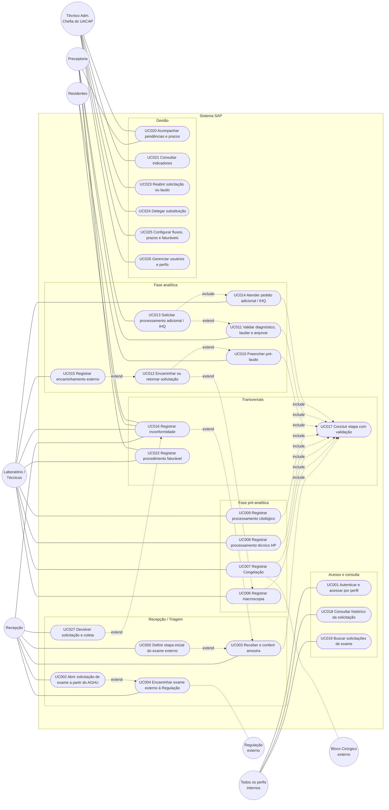

# Modelagem de Casos de Uso

> **Sistema:** Serviço de Anatomia Patológica (SAP) — HC-UFPE / SETISD
> **Origem:** `02-requisitos.md` (RF001 a RF029), `00-validacao-negocio.md` (atores, regras RN-01 a RN-07, pontos de decisão) e o *Feedback do fluxo atual do processo*.
> **Termo de trabalho:** a unidade acompanhada pelo SAP é a **solicitação de exame** do AGHU. "Caso de uso" é o termo técnico deste documento e não se refere a ela.

## 1. Atores

| Ator | Papel no SAP |
| :--- | :--- |
| **Recepção** | Abre no SAP a solicitação de exame já existente no AGHU, recebe e confere a amostra, imprime a etiqueta, registra o encaminhamento de exames externos à Regulação, devolve ao setor de origem as solicitações com inconformidade e indica a etapa inicial dos exames externos. |
| **Laboratório / Técnicos** | Registra macroscopia, Congelação, processamento técnico, pedidos adicionais, IHQ e envios externos. |
| **Residentes** | Preenchem o pré-laudo após a análise da peça. |
| **Validação / Preceptoria** | Preceptores, que são os próprios patologistas do setor: validam o pré-laudo, registram o diagnóstico e o laudo, arquivam a solicitação de exame, pedem processamentos adicionais e acompanham as solicitações que aguardam por eles. |
| **Técnico Administrativo (Chefia do UACAP)** | Acompanha painéis e indicadores, reabre solicitações, delega substituições, define configurações de negócio e gerencia os usuários e perfis do SAP. |
| **Regulação do hospital** *(externo)* | Cadastra no AGHU os pacientes de exames externos e abre as respectivas solicitações de exame. |
| **Bloco Cirúrgico** *(externo)* | Solicita exames e recebe a resposta da Congelação. |

> **Atores externos:** a forma como Regulação e Bloco Cirúrgico vão interagir com o SAP ainda não foi definida (`00-validacao-negocio.md`, seção 6). Por ora eles aparecem como atores secundários, sem acesso direto ao sistema. O SAP registra o encaminhamento de dados à Regulação (UC004), mas o exame externo só passa a existir como solicitação de exame depois que a Regulação cadastra o paciente e abre a solicitação no AGHU (RN-02). O SAP também registra o aviso ao Bloco Cirúrgico (UC007).

## 2. Diagrama de Casos de Uso

**Convenções:** linha cheia liga ator a caso de uso; linha tracejada com `include` indica que o caso de uso sempre usa o outro (UC017 valida a conclusão de qualquer etapa); `extend` indica um desvio opcional (UC002, quando a solicitação de um exame externo aparece no AGHU, vincula e encerra o encaminhamento do UC004). UC012 (encaminhar/retornar) pode ser acionado por qualquer responsável de etapa. UC027 (devolução) só ocorre a partir de uma inconformidade registrada (UC016).

## 3. Especificação dos Casos de Uso

> Padrão de cada caso de uso: ator, pré-condição, fluxo principal, fluxos alternativos e exceções, pós-condição, requisitos atendidos e detalhamento CARE.

### UC001 - Autenticar e acessar por perfil
* **Ator**: Todos os perfis internos.
* **Pré-condição**: Usuário com conta institucional (AD) e perfil mapeado.
* **Fluxo**: Informar credenciais → Sistema consulta o AD → Sistema emite sessão → Sistema libera apenas as funções do perfil.
* **Alternativos/Exceções**: Credenciais inválidas (401); usuário sem perfil mapeado (403); ação fora da alçada do perfil (403).
* **Pós-condição**: Sessão ativa associada ao usuário; acessos registrados.
* **Requisitos**: RF001, RF002, RNF001, RNF003.

#### [CARE-UC001] Implementação da autenticação e do controle de acesso
* **Context**: Servidor LDAP configurado e grupos do AD mapeados para os 5 perfis.
* **Action**: Implementar login via AD, emissão de token e verificação de perfil por rota e por etapa do fluxo.
* **Result**: Usuário autenticado acessa somente as ações do seu perfil; falhas retornam 401 ou 403.
* **Evaluation**: Teste automatizado cobre login válido, login inválido e uma ação proibida para cada um dos 5 perfis, com 100% de acerto.

### UC002 - Abrir solicitação de exame a partir do AGHU
* **Ator**: Recepção.
* **Pré-condição**: Solicitação de exame existente e aceita no AGHU; usuário autenticado como Recepção.
* **Fluxo**: Informar o número da solicitação → Sistema consulta o AGHU Slave → Sistema exibe paciente, solicitação e amostras já preenchidos, somente leitura → Recepção confirma → Sistema abre a solicitação de exame no SAP com identificador interno `SIGLA-NNNN/AA` (numeração por sigla, reiniciada a cada ano) e vínculo com a solicitação e a amostra do AGHU.
* **Alternativos/Exceções**: Solicitação inexistente no AGHU (nada é criado e não há cadastro manual; mensagem clara, 404); AGHU indisponível (sinalização sem criar registro parcial); solicitação já aberta no SAP (bloqueia duplicidade, 409).
* **Pós-condição**: Solicitação de exame aberta, vinculada e auditada; campos de origem AGHU imutáveis para todos os perfis.
* **Requisitos**: RF003, RF004, RNF005; RN-01, RN-02.

#### [CARE-UC002] Implementação da abertura da solicitação de exame
* **Context**: Conexão somente leitura ao AGHU Slave configurada e modelo de dados com chave de vínculo.
* **Action**: Implementar consulta ao AGHU e abertura da solicitação de exame com amostras vinculadas, recebendo apenas o número da solicitação.
* **Result**: Solicitação persistida com identificador interno único e dados do AGHU não editáveis; sem vínculo, a abertura é recusada (422); dados de paciente, solicitação ou amostra enviados pelo cliente são ignorados ou recusados.
* **Evaluation**: Teste com AGHU simulado valida: abertura com dados completos, solicitação inexistente no AGHU, AGHU fora do ar, duplicidade, tentativa de editar campo de origem AGHU e ausência de qualquer comando de escrita no AGHU.

### UC003 - Receber e conferir amostra
* **Ator**: Recepção.
* **Pré-condição**: Solicitação de exame aberta (UC002); amostra fisicamente recebida.
* **Fluxo**: Selecionar a solicitação → Conferir dados e condição da amostra → Registrar recebimento (data, hora, profissional) → Imprimir etiqueta com identificador interno → Concluir etapa (UC017).
* **Alternativos/Exceções**: Divergência ou condicionamento inadequado (UC016); inconformidade não resolvida no setor (UC027); exame externo (UC005). O protocolo físico assinado continua existindo ao lado do registro.
* **Pós-condição**: Etapa Recepção concluída com responsável e horário; etiqueta impressa.
* **Requisitos**: RF006, RF019; RN-01, RN-03.

#### [CARE-UC003] Implementação do recebimento
* **Context**: Solicitação de exame aberta e usuário com perfil de Recepção.
* **Action**: Implementar tela e serviço de recebimento, com geração da etiqueta imprimível.
* **Result**: Recebimento registrado com autor e horário; nenhum dado de origem AGHU editável pela Recepção.
* **Evaluation**: Testes validam recebimento válido, tentativa de editar dado de origem AGHU (negada) e conteúdo da etiqueta contra o modelo de `05-interfaces.md`.

### UC004 - Encaminhar exame externo à Regulação
* **Ator**: Recepção. **Ator secundário**: Regulação do hospital (externo).
* **Pré-condição**: Exame externo chegou à Anatomia Patológica e o paciente ou a solicitação ainda não existem no AGHU.
* **Fluxo**: Registrar no SAP os dados enviados à Regulação, a data e o responsável → O encaminhamento entra na lista "aguardando cadastro" (ainda não é uma solicitação de exame: não tem identificador interno nem etapas) → Regulação cadastra o paciente e abre a solicitação no AGHU → Recepção abre a solicitação no SAP (UC002) e a vincula ao encaminhamento → Encaminhamento encerrado; seguem o recebimento (UC003) e a definição da etapa inicial (UC005).
* **Alternativos/Exceções**: Cadastro demora além do esperado (aparece em pendências, UC020); tentativa de abrir a solicitação antes do cadastro no AGHU (recusada, 404, com orientação).
* **Pós-condição**: Encaminhamento vinculado à solicitação de exame e preservado no histórico dela.
* **Requisitos**: RF007, RF004, RF023; RN-02.

#### [CARE-UC004] Implementação do encaminhamento à Regulação
* **Context**: Exame externo cujo paciente ou solicitação ainda não existe no AGHU.
* **Action**: Implementar o registro do encaminhamento, separado das solicitações de exame, a lista "aguardando cadastro" e a ação de vincular o encaminhamento à solicitação aberta pelo UC002. Não implementar tela nem rota de criação manual de solicitação.
* **Result**: Encaminhamento visível nas pendências enquanto aguarda; não aparece na busca de solicitações nem aceita etapas, material ou laudo; ao ser vinculado, sai da lista e passa ao histórico da solicitação.
* **Evaluation**: Teste valida a criação do encaminhamento sem solicitação, a recusa de qualquer processamento sobre ele e o vínculo e encerramento quando a solicitação, já cadastrada no AGHU simulado, é aberta.

### UC005 - Definir etapa inicial do exame externo
* **Ator**: Recepção.
* **Pré-condição**: Solicitação do exame externo aberta no SAP (UC002, após o UC004) e recebida (UC003).
* **Fluxo**: Indicar a etapa inicial → Marcar etapas já realizadas fora do HC → Sistema registra as marcações distintas das etapas feitas no HC → Solicitação segue a partir da etapa escolhida.
* **Alternativos/Exceções**: Etapa inicial incompatível com o tipo de exame (rejeitada pelo fluxo configurado).
* **Pós-condição**: Solicitação posicionada na etapa inicial indicada.
* **Requisitos**: RF018, RF005.

#### [CARE-UC005] Implementação da etapa inicial do exame externo
* **Context**: Fluxos por tipo de exame configurados.
* **Action**: Implementar escolha da etapa inicial e dos checks de etapas externas.
* **Result**: Solicitação inicia na etapa escolhida; etapas externas aparecem como "realizadas externamente".
* **Evaluation**: Teste valida início em cada etapa permitida e recusa de etapa inválida; apenas exames externos têm essa opção.

### UC006 - Registrar macroscopia e laudo macroscópico
* **Ator**: Laboratório / Técnicos.
* **Pré-condição**: Solicitação de HP com Recepção concluída.
* **Fluxo**: Preencher formulário de macroscopia → Registrar peças e cassetes gerados → Emitir laudo macroscópico → Concluir etapa (UC017).
* **Alternativos/Exceções**: Erro identificado na amostra (retorno à Recepção pelo UC012, com motivo); campo obrigatório vazio (conclusão bloqueada).
* **Pós-condição**: Laudo macroscópico registrado, independente do laudo final; cassetes rastreáveis.
* **Requisitos**: RF008, RF012, RF015; RN-02.

#### [CARE-UC006] Implementação da macroscopia
* **Context**: Solicitação de HP recebida e etapa de Recepção concluída.
* **Action**: Implementar formulário padronizado de macroscopia, emissão do laudo macroscópico e criação dos cassetes como material derivado.
* **Result**: Macroscopia concluída somente com campos obrigatórios; cassetes vinculados à solicitação de exame.
* **Evaluation**: Testes validam conclusão completa, bloqueio com campo vazio e vínculo de cada cassete à solicitação de origem.

### UC007 - Registrar Congelação
* **Ator**: Laboratório / Técnicos. **Ator secundário**: Bloco Cirúrgico (externo).
* **Pré-condição**: Solicitação de Congelação recebida pela Recepção no AGHU.
* **Fluxo**: Registrar análise macroscópica preliminar → Registrar o resultado e o laudo da Congelação (emitido no AGHU) → Registrar o aviso ao Bloco Cirúrgico → Encaminhar o material de volta à Recepção para a solicitação seguinte (HP).
* **Alternativos/Exceções**: A solicitação de HP chega depois, é aberta à parte (UC002) e inicia o fluxo após a etapa de Corte (Coloração em diante).
* **Pós-condição**: Ciclo da Congelação concluído e histórico preservado.
* **Requisitos**: RF009, RF005, RF019.

#### [CARE-UC007] Implementação da Congelação
* **Context**: Fluxo reduzido da CO configurado, com resposta em tempo curto.
* **Action**: Implementar o ciclo reduzido, o registro do aviso ao Bloco Cirúrgico e o retorno do material à Recepção.
* **Result**: Laudo da CO e aviso registrados; a solicitação de HP seguinte começa após o Corte.
* **Evaluation**: Teste valida o ciclo completo da CO e que o HP derivado inicia em Coloração.

### UC008 - Registrar processamento técnico HP
* **Ator**: Laboratório / Técnicos.
* **Pré-condição**: Macroscopia concluída (ou etapa inicial definida em exame externo, ou HP derivado de CO).
* **Fluxo**: Escolher início por Histotécnico ou Preparo manual → Registrar inclusão → Corte → Coloração → Montagem, cada uma com responsável e horário → Concluir etapa (UC017).
* **Alternativos/Exceções**: Pedido de recorte ou coloração especial retorna a esta etapa (UC012, UC014).
* **Pós-condição**: Blocos e lâminas criados e rastreáveis.
* **Requisitos**: RF010, RF012.

#### [CARE-UC008] Implementação do processamento técnico HP
* **Context**: Cassetes criados na macroscopia.
* **Action**: Implementar o registro sequencial das etapas técnicas e a criação de blocos e lâminas.
* **Result**: Etapas registradas na ordem; cada lâmina e bloco com etapa atual consultável.
* **Evaluation**: Testes validam as duas formas de início, a ordem das etapas e a rastreabilidade até a solicitação de exame.

### UC009 - Registrar processamento citológico (CG e CCV)
* **Ator**: Laboratório / Técnicos.
* **Pré-condição**: Solicitação de Citologia Geral ou Cérvico-vaginal com Recepção concluída.
* **Fluxo**: Informar se o material é líquido → Se sim, registrar centrifugação e informar se há fragmento (cell-block) → Se há fragmento, registrar o preparo na bancada do HP (preparo manual, inclusão, corte, coloração, montagem) e o retorno à bancada da Citologia → Registrar coloração, montagem e distribuição.
* **Alternativos/Exceções**: Sem líquido ou sem fragmento: segue direto para coloração.
* **Pós-condição**: Material distribuído; a solicitação segue para a Microscopia.
* **Requisitos**: RF011, RF012.

#### [CARE-UC009] Implementação do processamento citológico
* **Context**: Árvore de decisão da Citologia definida no fluxo (seção 4.2 do `02-requisitos.md`).
* **Action**: Implementar as decisões "é líquido?" e "tem fragmento?" e as rotas resultantes.
* **Result**: Caminho percorrido registrado; as três rotas terminam em coloração, montagem e distribuição.
* **Evaluation**: Teste cobre as três rotas (líquido com fragmento, líquido sem fragmento, sem líquido) com 100% de acerto.

### UC010 - Preencher pré-laudo
* **Ator**: Residentes.
* **Pré-condição**: Lâminas prontas (ou material recebido em exame externo nessa etapa).
* **Fluxo**: Abrir a solicitação de exame → Registrar a análise da peça no pré-laudo, em tela única → Enviar à Preceptoria → Concluir etapa (UC017).
* **Alternativos/Exceções**: Erro de recepção ou de cadastro detectado (retorno pelo UC012, sem reiniciar o processo); necessidade de revisão, recorte, IHQ ou envio externo (UC012).
* **Pós-condição**: Pré-laudo salvo com autor e horário; solicitação "aguardando validação".
* **Requisitos**: RF013, RF015.

#### [CARE-UC010] Implementação do pré-laudo
* **Context**: Material pronto para análise e usuário com perfil de Residente.
* **Action**: Implementar tela única de pré-laudo e envio à Preceptoria.
* **Result**: Pré-laudo registrado com autor e horário; solicitação muda de status.
* **Evaluation**: Testes validam envio, bloqueio com campo obrigatório vazio e recusa de acesso a outros perfis.

### UC011 - Validar diagnóstico, registrar laudo e arquivar
* **Ator**: Validação / Preceptoria.
* **Pré-condição**: Pré-laudo enviado.
* **Fluxo**: Revisar o pré-laudo → Registrar o diagnóstico → Lançar o laudo no AGHU, com o laudo da IHQ anexado apenas quando houve IHQ solicitada → Registrar no SAP a confirmação do lançamento → Arquivar a solicitação de exame (UC017 valida pendências).
* **Alternativos/Exceções**: Diagnóstico não fecha (UC012 e UC013: revisão, recorte/coloração especial, IHQ ou rede externa); pendências abertas bloqueiam o arquivamento. A IHQ nem sempre é solicitada: só quando houver IHQ solicitada o arquivamento espera o laudo da IHQ; sem IHQ solicitada, essa verificação não se aplica.
* **Pós-condição**: Solicitação concluída e arquivada, com responsável registrado.
* **Requisitos**: RF014, RF016, RF019; RN-03.

#### [CARE-UC011] Implementação da validação e do arquivamento
* **Context**: Pré-laudo enviado e usuário com perfil de Preceptoria.
* **Action**: Implementar validação, registro do diagnóstico e da confirmação de lançamento no AGHU (indicando o laudo de IHQ anexado, quando houve IHQ solicitada) e arquivamento.
* **Result**: Solicitação arquivada somente sem pendências; status coerente com as etapas registradas.
* **Evaluation**: Testes validam arquivamento com sucesso e arquivamento negado com pendência aberta ou etapa obrigatória ausente; solicitação sem IHQ solicitada arquiva normalmente; solicitação com IHQ solicitada e ainda sem laudo da IHQ não arquiva.

### UC012 - Encaminhar ou retornar solicitação de exame
* **Ator**: Responsável pela etapa em que a solicitação se encontra (Laboratório, Residentes ou Preceptoria).
* **Pré-condição**: Solicitação em etapa que permita encaminhamento ou retorno para o tipo de exame (tabela 4.3 do `02-requisitos.md`).
* **Fluxo**: Escolher o destino permitido → Informar o motivo (obrigatório) → Sistema move a solicitação sem reiniciar o processo e preserva todo o histórico → Quando os ajustes terminam, a solicitação retorna à etapa de origem.
* **Alternativos/Exceções**: Destino inválido para o tipo de exame (409); motivo ausente (422).
* **Pós-condição**: Solicitação na etapa de destino; encaminhamento no histórico.
* **Requisitos**: RF015; RN-04. Quem pode retornar a solicitação na Microscopia depende do ponto de decisão 3. A devolução ao setor de origem é outro caso de uso (UC027).

#### [CARE-UC012] Implementação dos encaminhamentos e retornos
* **Context**: Tabela de encaminhamentos permitidos por tipo de exame configurada.
* **Action**: Implementar a ação de encaminhar/retornar com motivo obrigatório e validação do destino.
* **Result**: Solicitação muda de etapa sem perder registros anteriores.
* **Evaluation**: Teste cobre todos os pares origem/destino da tabela 4.3, recusa de destinos inválidos e exigência de motivo.

### UC013 - Solicitar processamento adicional ou IHQ
* **Ator**: Validação / Preceptoria.
* **Pré-condição**: Solicitação em Microscopia com diagnóstico não fechado.
* **Fluxo**: Escolher o tipo de pedido (recorte, coloração especial, revisão da peça, painel ou ampliação de IHQ) → Descrever a necessidade → Sistema vincula o pedido à solicitação de exame original e o coloca na fila do Laboratório.
* **Alternativos/Exceções**: Pedido sem solicitação de origem (impossível por regra).
* **Pós-condição**: Pedido registrado e visível para o Laboratório.
* **Requisitos**: RF016; RN-02. Necessidade de aprovação prévia da Chefia depende do ponto de decisão 4.

#### [CARE-UC013] Implementação do pedido adicional
* **Context**: Solicitação com diagnóstico em aberto e usuário com perfil de Preceptoria.
* **Action**: Implementar formulário de pedido e fila do Laboratório.
* **Result**: Pedido vinculado à solicitação de exame e notificado ao Laboratório.
* **Evaluation**: Testes validam criação do pedido, vínculo à solicitação e recusa de pedido por perfil sem permissão.

### UC014 - Atender pedido de processamento adicional ou IHQ
* **Ator**: Laboratório / Técnicos.
* **Pré-condição**: Pedido na fila (UC013).
* **Fluxo**: Abrir o pedido → Executar o procedimento → Registrar resultado e material gerado; no caso da IHQ, registrar o laudo da IHQ, que é anexado ao laudo principal → Concluir (UC017) → A solicitação volta à Microscopia.
* **Alternativos/Exceções**: IHQ enviada a hospital conveniado (UC015); o laudo da IHQ, ao retornar, também é anexado ao laudo principal.
* **Pós-condição**: Resultado associado à solicitação de exame original; laudo da IHQ vinculado ao laudo principal.
* **Requisitos**: RF016, RF012.

#### [CARE-UC014] Implementação do atendimento ao pedido
* **Context**: Pedido aberto na fila do Laboratório.
* **Action**: Implementar registro da execução, do material gerado e do laudo da IHQ, devolvendo a solicitação à Microscopia.
* **Result**: Resultado vinculado à solicitação original; nenhum registro isolado; laudo da IHQ sempre ligado a um laudo principal.
* **Evaluation**: Testes validam o retorno da solicitação à Microscopia e que um laudo de IHQ sem laudo principal vinculado é recusado.

### UC015 - Registrar encaminhamento externo
* **Ator**: Laboratório / Técnicos.
* **Pré-condição**: Decisão de enviar material à rede externa terceirizada ou hospital conveniado.
* **Fluxo**: Registrar envio e finalidade → Acompanhar a situação → Registrar o retorno do material ou resultado → A solicitação volta à Microscopia.
* **Alternativos/Exceções**: Material não retornou no prazo esperado (alerta em UC020).
* **Pós-condição**: Encaminhamento vinculado à solicitação de exame, com envio, finalidade, situação e retorno.
* **Requisitos**: RF017; RN-02. Quem confirma o retorno e o prazo dependem do ponto de decisão 7.

#### [CARE-UC015] Implementação do encaminhamento externo
* **Context**: Solicitação com diagnóstico não fechado e necessidade de processamento externo.
* **Action**: Implementar registro de envio, situação e retorno, com alerta de atraso.
* **Result**: Situação do material consultável a qualquer momento.
* **Evaluation**: Teste valida o ciclo envio → retorno e o alerta quando o prazo é excedido.

### UC016 - Registrar inconformidade ou rejeição
* **Ator**: Recepção, Laboratório, Residentes ou Preceptoria.
* **Pré-condição**: Divergência, ausência de informação ou condicionamento inadequado identificado.
* **Fluxo**: Registrar o motivo (lista configurável) → Sistema vincula à solicitação de exame e sinaliza pendência → Responsável registra a resolução → Pendência encerrada.
* **Alternativos/Exceções**: Inconformidade com retorno à Recepção (UC012); inconformidade não resolvida no setor, na Recepção (devolução, UC027).
* **Pós-condição**: Ocorrência com motivo, situação e resolução vinculados à solicitação.
* **Requisitos**: RF020; RN-06.

#### [CARE-UC016] Implementação do registro de inconformidades
* **Context**: Solicitação de exame em qualquer etapa.
* **Action**: Implementar registro de inconformidade com motivo, situação e resolução.
* **Result**: A solicitação não segue o fluxo normal enquanto houver inconformidade sem tratamento.
* **Evaluation**: Testes validam registro, bloqueio do avanço, encerramento com resolução e encaminhamento para devolução.

### UC017 - Concluir etapa com validação
* **Ator**: Qualquer perfil que conclui uma etapa (caso de uso incluído pelos demais).
* **Pré-condição**: Etapa em andamento.
* **Fluxo**: Sistema verifica campos obrigatórios e pendências → Registra a conclusão com etapa, data/hora e responsável → Atualiza o status da solicitação de exame a partir das etapas registradas.
* **Alternativos/Exceções**: Campo obrigatório vazio ou pendência aberta (conclusão bloqueada, 409/422, com a causa).
* **Pós-condição**: Status da solicitação coerente com o histórico. Há dois encerramentos possíveis: com laudo ("Concluída") ou por devolução ("Devolvida"/"Cancelada", UC027).
* **Requisitos**: RF019, RF021; RN-03, RN-04.

#### [CARE-UC017] Implementação da validação de conclusão
* **Context**: Campos obrigatórios por etapa definidos.
* **Action**: Implementar a regra central de conclusão e o cálculo do status derivado, incluindo o status final de devolução.
* **Result**: Nenhuma solicitação aparece como concluída, liberada ou arquivada com pendências; solicitação devolvida não avança de etapa.
* **Evaluation**: Teste valida os estados possíveis da solicitação e que o status nunca contradiz o histórico.

### UC018 - Consultar histórico da solicitação de exame
* **Ator**: Todos os perfis internos (respeitando permissões).
* **Pré-condição**: Solicitação de exame aberta no SAP (inclusive encerrada ou devolvida).
* **Fluxo**: Abrir a solicitação → Abrir a linha do tempo → Ver cada movimentação (etapa, data/hora, responsável) e cada alteração (valor anterior e novo).
* **Pós-condição**: Nenhuma; apenas consulta.
* **Requisitos**: RF021, RNF002, RNF006; RN-04.

#### [CARE-UC018] Implementação da linha do tempo
* **Context**: Movimentações e alterações gravadas em `audit_logs`.
* **Action**: Implementar a tela e a consulta do histórico por solicitação de exame.
* **Result**: Trajetória completa reconstruível, sem apagar ou sobrescrever registros.
* **Evaluation**: Teste valida que toda mutação aparece na linha do tempo com autor e valores antes/depois.

### UC019 - Buscar solicitações de exame
* **Ator**: Todos os perfis internos.
* **Pré-condição**: Usuário autenticado.
* **Fluxo**: Informar filtros (número da solicitação, prontuário do paciente, identificador interno, tipo de exame, etapa, status) → Sistema lista as solicitações que o perfil pode ver, inclusive as encerradas e devolvidas → Abrir a solicitação desejada.
* **Alternativos/Exceções**: Nenhum resultado (mensagem informativa).
* **Pós-condição**: Nenhuma.
* **Requisitos**: RF027, RF002.

#### [CARE-UC019] Implementação da busca
* **Context**: Solicitações de exame abertas no SAP.
* **Action**: Implementar consulta paginada com os filtros definidos.
* **Result**: Lista restrita ao que o perfil pode ver, com localização de amostra, bloco ou lâmina pelo identificador interno.
* **Evaluation**: Testes validam cada filtro isoladamente e combinados, a restrição por perfil e a presença de solicitações devolvidas no resultado.

### UC020 - Acompanhar painel de pendências e prazos
* **Ator**: Técnico Administrativo (Chefia do UACAP); Validação / Preceptoria (visão das solicitações e pedidos que aguardam por ela).
* **Pré-condição**: Solicitações registradas; prazos de referência configurados.
* **Fluxo**: Abrir o painel → Ver solicitações pendentes, atrasadas ou aguardando complemento, por etapa e por responsável, com a contagem de quantas faltam, e os encaminhamentos à Regulação aguardando cadastro → Abrir a solicitação ou o encaminhamento para agir.
* **Alternativos/Exceções**: Sem prazo configurado para o tipo de exame (painel não marca atraso e avisa).
* **Pós-condição**: Nenhuma.
* **Requisitos**: RF023; OBJ-04, OBJ-05. Prazos dependem do ponto de decisão 2.

#### [CARE-UC020] Implementação do painel
* **Context**: Prazos de referência definidos e movimentações com data/hora.
* **Action**: Implementar consulta e tela de pendências e atrasos com contagem e alertas, por etapa e por responsável.
* **Result**: Solicitações atrasadas, urgentes e aguardando complemento destacadas; cada preceptor (patologista) vê quantas solicitações e pedidos aguardam por ele.
* **Evaluation**: Teste com massa de dados valida a contagem de atrasos por etapa e por responsável e o alerta de material externo não retornado.

### UC021 - Consultar indicadores
* **Ator**: Técnico Administrativo (Chefia do UACAP).
* **Pré-condição**: Dados de movimentação registrados.
* **Fluxo**: Escolher período e tipo de exame → Sistema calcula os 7 indicadores (turnaround time, erro de transposição, cumprimento de prazos, pendências e atrasos, automação do preenchimento, rastreabilidade, inconsistências, incluindo rejeições e devoluções) → Exibir.
* **Pós-condição**: Nenhuma.
* **Requisitos**: RF024.

#### [CARE-UC021] Implementação dos indicadores
* **Context**: Movimentações, inconformidades e devoluções registradas com data/hora.
* **Action**: Implementar as consultas dos 7 indicadores da seção 8 do documento de negócio.
* **Result**: Indicadores por período e tipo de exame, acessíveis à Chefia.
* **Evaluation**: Resultados conferem com uma massa de dados de valores conhecidos.

### UC022 - Registrar procedimento faturável
* **Ator**: Laboratório / Técnicos e Validação / Preceptoria (conforme a etapa em que o procedimento ocorre; a confirmar com a lista do ponto de decisão 8).
* **Pré-condição**: Procedimento realizado que conste na lista de faturáveis.
* **Fluxo**: Ao concluir a etapa, informar o procedimento faturável → Sistema registra de forma estruturada, vinculado à solicitação de exame → Consulta consolidada por solicitação e período.
* **Alternativos/Exceções**: Procedimento fora da lista (não registrado como faturável).
* **Pós-condição**: Procedimento contabilizável sem planilha paralela.
* **Requisitos**: RF025; RN-07; OBJ-07.

#### [CARE-UC022] Implementação do registro de faturáveis
* **Context**: Lista de procedimentos faturáveis definida e configurada.
* **Action**: Implementar registro estruturado e consulta consolidada.
* **Result**: Todo procedimento faturável realizado fica registrado e consultável.
* **Evaluation**: Testes validam registro, consulta por período e recusa de procedimento fora da lista.

### UC023 - Reabrir solicitação de exame ou laudo concluído
* **Ator**: Técnico Administrativo (Chefia do UACAP). A definição de quem pode reabrir (Chefia ou preceptor responsável) depende do ponto de decisão 5.
* **Pré-condição**: Solicitação concluída, liberada ou arquivada.
* **Fluxo**: Selecionar a solicitação → Informar a justificativa (obrigatória) → Sistema reabre, preserva o laudo anterior e avisa os responsáveis → A solicitação retorna à etapa necessária.
* **Alternativos/Exceções**: Usuário sem permissão (403); justificativa ausente (422). O laudo já lançado no AGHU exige apoio do SETISD.
* **Pós-condição**: Solicitação reaberta; versão anterior preservada.
* **Requisitos**: RF022, RF021; RN-04.

#### [CARE-UC023] Implementação da reabertura
* **Context**: Regra de reabertura definida pelo setor.
* **Action**: Implementar reabertura com justificativa obrigatória e permissão restrita.
* **Result**: Laudo anterior intacto e reabertura auditada.
* **Evaluation**: Testes validam reabertura autorizada, recusa sem permissão ou sem justificativa e preservação do laudo anterior.

### UC024 - Delegar substituição na ausência
* **Ator**: Técnico Administrativo (Chefia do UACAP).
* **Pré-condição**: Titular de validação ou chefia ausente por período previsto.
* **Fluxo**: Escolher o substituto → Definir início e fim → Sistema concede as permissões somente nesse período → Registra a delegação.
* **Alternativos/Exceções**: Período vencido (permissões removidas automaticamente).
* **Pós-condição**: Substituto com permissões temporárias; delegação auditada.
* **Requisitos**: RF026; RN-04, RN-05. Modelo (lista fixa ou delegação temporária) depende do ponto de decisão 6.

#### [CARE-UC024] Implementação da delegação
* **Context**: Perfil de Chefia com permissão de delegar.
* **Action**: Implementar delegação temporária com início, fim e substituto.
* **Result**: Permissões do substituto expiram ao fim do período.
* **Evaluation**: Teste valida o acesso durante o período e a perda do acesso depois dele.

### UC025 - Configurar fluxos, prazos e procedimentos faturáveis
* **Ator**: Técnico Administrativo (Chefia do UACAP), com apoio do SETISD.
* **Pré-condição**: Decisões do negócio tomadas (pontos de decisão 1, 2, 3, 4, 7 e 8).
* **Fluxo**: Abrir a configuração → Ajustar etapas e transições por tipo de exame, prazos de referência, motivos de inconformidade e lista de faturáveis → Sistema valida e grava, com histórico da alteração.
* **Alternativos/Exceções**: Configuração incoerente (por exemplo, transição que deixa etapa sem saída) é recusada.
* **Pós-condição**: Novas regras valem para as solicitações a partir da alteração.
* **Requisitos**: RF005, RNF011.

#### [CARE-UC025] Implementação da configuração
* **Context**: Fluxos, prazos e listas ficam em dados, não em código.
* **Action**: Implementar telas e validações de configuração, com auditoria.
* **Result**: Mudança de regra sem alterar código; alterações auditadas.
* **Evaluation**: Teste valida a recusa de configurações incoerentes e que solicitações em andamento não são afetadas retroativamente.

### UC026 - Gerenciar usuários e perfis
* **Ator**: Técnico Administrativo (Chefia do UACAP).
* **Pré-condição**: Usuário autenticado com perfil de Chefia. A primeira Chefia é cadastrada pela TI com o script `scripts/provision_sap_user.py`.
* **Fluxo**: Abrir Configurações → Incluir usuário: informar o login de rede → Sistema consulta o AD e mostra nome, e-mail e setor → Escolher o perfil → Sistema grava o acesso. Também: alterar o perfil de um usuário, inativar ou reativar o acesso.
* **Alternativos/Exceções**: Login inexistente ou desativado no AD (inclusão recusada); login já cadastrado (sugere alterar perfil ou reativar); tentativa de alterar o próprio perfil ou inativar o próprio acesso (recusada); grupo do AD exigido para o perfil ausente, quando a instituição configurar esse mapa (recusada).
* **Pós-condição**: Acesso e perfil valem na próxima requisição do usuário; alteração auditada (SEGURANCA) com valor anterior e novo. Nenhum usuário é excluído.
* **Requisitos**: RF028, RF002; RN-04, RN-05.

#### [CARE-UC026] Implementação da gestão de usuários
* **Context**: Tabela `authorized_users` no banco local; consulta ao AD por conta de serviço.
* **Action**: Implementar SQL, provider, controller e router `/api/admin/usuarios` restritos à Chefia, e a tela em Configurações.
* **Result**: Usuários incluídos, alterados e inativados sem exclusão física, com auditoria na mesma transação.
* **Evaluation**: `tests/test_usuarios.py` cobre acesso só da Chefia, inclusão com nome do AD, duplicidade, login fora do AD, auto-alteração, inativação com efeito imediato e atomicidade da auditoria.

### UC027 - Devolver solicitação e coleta ao setor de origem
* **Ator**: Recepção.
* **Pré-condição**: Inconformidade registrada na Recepção (UC016) que não pode ser resolvida no setor.
* **Fluxo**: Escolher "Devolver ao setor de origem" → Selecionar o motivo → Explicar, se quiser, por que a solicitação está sendo devolvida (caixa de texto opcional) → Confirmar → Sistema encerra a solicitação com o status final de devolução, retira-a das filas de trabalho e registra data/hora e responsável → Recepção devolve a solicitação no AGHU, conforme o ponto de decisão 10.
* **Alternativos/Exceções**: Motivo ausente (422).
* **Pós-condição**: Solicitação encerrada como "Devolvida" ou "Cancelada" (nome a definir), no lugar de "Concluída"; nada é excluído, e a solicitação continua consultável (UC018, UC019).
* **Requisitos**: RF029, RF020; RN-04, RN-06.

#### [CARE-UC027] Implementação da devolução
* **Context**: Inconformidade registrada e usuário com perfil de Recepção.
* **Action**: Implementar a ação de devolução com motivo obrigatório, explicação opcional e encerramento da solicitação com status final próprio.
* **Result**: Solicitação devolvida fora das filas, sem possibilidade de avançar de etapa, com motivo, explicação (se houver), data/hora e responsável no histórico.
* **Evaluation**: Testes validam devolução com e sem explicação, recusa sem motivo, ausência da solicitação devolvida nas filas, presença na busca e bloqueio de qualquer avanço de etapa.

## 4. Rastreabilidade

| Caso de uso | Requisitos funcionais | Regras de negócio |
| :--- | :--- | :--- |
| UC001 | RF001, RF002 | RN-05 |
| UC002 | RF003, RF004 | RN-01, RN-02 |
| UC003 | RF006, RF019 | RN-01, RN-03 |
| UC004 | RF007, RF004, RF023 | RN-02 |
| UC005 | RF018, RF005 | RN-03 |
| UC006 | RF008, RF012, RF015 | RN-02 |
| UC007 | RF009 | RN-03 |
| UC008 | RF010, RF012 | RN-02 |
| UC009 | RF011, RF012 | RN-02 |
| UC010 | RF013, RF015 | RN-04 |
| UC011 | RF014, RF016, RF019 | RN-03 |
| UC012 | RF015 | RN-04 |
| UC013 | RF016 | RN-02 |
| UC014 | RF016, RF012 | RN-02 |
| UC015 | RF017 | RN-02 |
| UC016 | RF020 | RN-06 |
| UC017 | RF019, RF021 | RN-03, RN-04 |
| UC018 | RF021 | RN-04 |
| UC019 | RF027 | n/a |
| UC020 | RF023 | n/a |
| UC021 | RF024 | n/a |
| UC022 | RF025 | RN-07 |
| UC023 | RF022 | RN-04 |
| UC024 | RF026 | RN-05 |
| UC025 | RF005 | RN-03 |
| UC026 | RF028, RF002 | RN-04, RN-05 |
| UC027 | RF029, RF020 | RN-04, RN-06 |

Todos os RFs do `02-requisitos.md` (RF001 a RF029) têm pelo menos um caso de uso.

## 5. Pontos em aberto que afetam os casos de uso

| Ponto | Casos de uso afetados |
| :--- | :--- |
| Decisão 1: tipos de exame da primeira versão | UC005, UC007, UC009, UC025 |
| Decisão 2: prazos de referência | UC020, UC025 |
| Decisão 3: quem retorna a solicitação na Microscopia | UC010, UC011, UC012 |
| Decisão 4: aprovação de pedidos adicionais | UC013, UC014 |
| Decisão 5: rito de reabertura | UC023 |
| Decisão 6: modelo de substituição | UC024 |
| Decisão 7: IHQ em hospital conveniado | UC015 |
| Decisão 8: lista de faturáveis | UC022 |
| Decisão 10: devolução no SAP e no AGHU | UC027 |
| Nome do status final da devolução ("Devolvida" ou "Cancelada") | UC017, UC027 |
| Material devolvido que volta ao setor: abre-se nova solicitação no AGHU? | UC002, UC027 |
| Confirmar que a Regulação abre a solicitação do exame externo no AGHU | UC004 |
| Confirmar que a IHQ gera laudo próprio, anexado ao laudo principal | UC011, UC014 |
| Interação do Bloco Cirúrgico com o SAP (não definida) | UC007 |
| Quem emite o laudo da Congelação (Laboratório, Residentes ou Preceptoria) | UC007 |
| Lista de erros possíveis no retorno à Recepção | UC006, UC010, UC012 |
