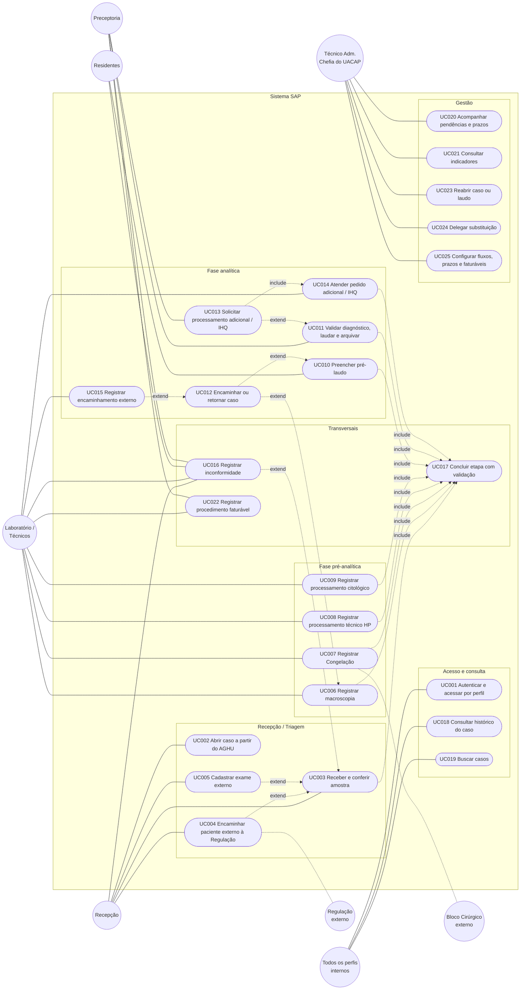

# Modelagem de Casos de Uso

> **Sistema:** Serviço de Anatomia Patológica (SAP) — HC-UFPE / SETISD
> **Origem:** `02-requisitos.md` (RF001 a RF027), `00-validacao-negocio.md` (atores, regras RN-01 a RN-07, pontos de decisão) e o *Feedback do fluxo atual do processo*.

## 1. Atores

| Ator | Papel no SAP |
| :--- | :--- |
| **Recepção** | Abre o caso, recebe e confere a amostra, imprime a etiqueta e cadastra exames externos. |
| **Laboratório / Técnicos** | Registra macroscopia, Congelação, processamento técnico, pedidos adicionais, IHQ e envios externos. |
| **Residentes** | Preenchem o pré-laudo após a análise da peça. |
| **Validação / Preceptoria** | Valida o pré-laudo, registra o diagnóstico e o laudo, arquiva o caso e pede processamentos adicionais. |
| **Técnico Administrativo (Chefia do UACAP)** | Acompanha painéis e indicadores, reabre casos, delega substituições e define configurações de negócio. |
| **Regulação do hospital** *(externo)* | Cadastra no AGHU os pacientes de exames externos. |
| **Bloco Cirúrgico** *(externo)* | Solicita exames e recebe a resposta da Congelação. |

> **Atores externos:** a forma como Regulação e Bloco Cirúrgico vão interagir com o SAP ainda não foi definida (`00-validacao-negocio.md`, seção 6). Por ora eles aparecem como atores secundários, sem acesso direto ao sistema: o SAP apenas registra o envio de dados à Regulação (UC004) e o aviso ao Bloco Cirúrgico (UC007).

## 2. Diagrama de Casos de Uso

**Convenções:** linha cheia liga ator a caso de uso; linha tracejada com `include` indica que o caso de uso sempre usa o outro (UC017 valida a conclusão de qualquer etapa); `extend` indica um desvio opcional. UC012 (encaminhar/retornar) pode ser acionado por qualquer responsável de etapa.

## 3. Especificação dos Casos de Uso

> Padrão de cada caso: ator, pré-condição, fluxo principal, fluxos alternativos e exceções, pós-condição, requisitos atendidos e detalhamento CARE.

### UC001 - Autenticar e acessar por perfil
* **Ator**: Todos os perfis internos.
* **Pré-condição**: Usuário com conta institucional (AD) e perfil mapeado.
* **Fluxo**: Informar credenciais → Sistema consulta o AD → Sistema emite sessão → Sistema libera apenas as funções do perfil.
* **Alternativos/Exceções**: Credenciais inválidas (401); usuário sem perfil mapeado (403); ação fora da alçada do perfil (403).
* **Pós-condição**: Sessão ativa associada ao usuário; acessos registrados.
* **Requisitos**: RF001, RF002, RNF001, RNF003.

#### [CARE-UC001] Implementação da autenticação e do controle de acesso
* **Context**: Servidor LDAP configurado e grupos do AD mapeados para os 5 perfis.
* **Action**: Implementar login via AD, emissão de token e verificação de perfil por rota e por etapa do fluxo.
* **Result**: Usuário autenticado acessa somente as ações do seu perfil; falhas retornam 401 ou 403.
* **Evaluation**: Teste automatizado cobre login válido, login inválido e uma ação proibida para cada um dos 5 perfis, com 100% de acerto.

### UC002 - Abrir caso a partir da solicitação do AGHU
* **Ator**: Recepção.
* **Pré-condição**: Solicitação aceita no AGHU; usuário autenticado como Recepção.
* **Fluxo**: Informar número da solicitação → Sistema consulta o AGHU Slave → Sistema exibe paciente, solicitação e amostras já preenchidos → Recepção confirma → Sistema cria o caso com identificador interno e vínculo com a solicitação e a amostra.
* **Alternativos/Exceções**: Solicitação inexistente (mensagem clara); AGHU indisponível (sinalização sem criar registro parcial); caso já aberto para a mesma solicitação (bloqueia duplicidade).
* **Pós-condição**: Caso criado, vinculado e auditado; campos de origem AGHU somente leitura.
* **Requisitos**: RF003, RF004, RNF005; RN-01, RN-02.

#### [CARE-UC002] Implementação da abertura de caso
* **Context**: Conexão somente leitura ao AGHU Slave configurada e modelo de dados com chave de vínculo.
* **Action**: Implementar consulta ao AGHU e criação do caso com amostras vinculadas.
* **Result**: Caso persistido com identificador interno único e dados do AGHU não editáveis; sem vínculo, a criação é recusada (422).
* **Evaluation**: Teste com AGHU simulado valida: criação com dados completos, solicitação inexistente, AGHU fora do ar, duplicidade e ausência de qualquer comando de escrita no AGHU.

### UC003 - Receber e conferir amostra
* **Ator**: Recepção.
* **Pré-condição**: Caso aberto (UC002); amostra fisicamente recebida.
* **Fluxo**: Selecionar caso → Conferir dados e condição da amostra → Registrar recebimento (data, hora, profissional) → Imprimir etiqueta com identificador interno → Concluir etapa (UC017).
* **Alternativos/Exceções**: Paciente externo sem cadastro (UC004); divergência ou condicionamento inadequado (UC016); exame externo (UC005). O protocolo físico assinado continua existindo ao lado do registro.
* **Pós-condição**: Etapa Recepção concluída com responsável e horário; etiqueta impressa.
* **Requisitos**: RF006, RF019; RN-03.

#### [CARE-UC003] Implementação do recebimento
* **Context**: Caso criado e usuário com perfil de Recepção.
* **Action**: Implementar tela e serviço de recebimento, com geração da etiqueta imprimível.
* **Result**: Recebimento registrado com autor e horário; dados sensíveis de identificação do exame não editáveis pela Recepção.
* **Evaluation**: Testes validam recebimento válido, tentativa de editar dado sensível (negada) e conteúdo da etiqueta contra o modelo de `05-interfaces.md`.

### UC004 - Encaminhar paciente externo à Regulação
* **Ator**: Recepção. **Ator secundário**: Regulação do hospital (externo).
* **Pré-condição**: Exame externo recebido e paciente sem cadastro no AGHU.
* **Fluxo**: Registrar os dados do paciente a enviar → Registrar envio (data e responsável) → Caso fica "aguardando cadastro" → Quando o cadastro aparecer no AGHU, registrar retorno (manual ou automático) → Caso liberado para seguir.
* **Alternativos/Exceções**: Cadastro demora além do esperado (aparece em pendências, UC020).
* **Pós-condição**: Caso com cadastro no AGHU e histórico do envio.
* **Requisitos**: RF007; RN-02.

#### [CARE-UC004] Implementação do envio à Regulação
* **Context**: Exame externo sem cadastro de paciente no AGHU.
* **Action**: Implementar registro de envio e retorno de cadastro, com bloqueio de avanço.
* **Result**: Caso não passa da Recepção sem cadastro; envio e retorno ficam no histórico.
* **Evaluation**: Teste valida o bloqueio sem cadastro e a liberação após o retorno.

### UC005 - Cadastrar exame externo
* **Ator**: Recepção.
* **Pré-condição**: Exame externo recebido (UC003).
* **Fluxo**: Indicar a etapa inicial → Marcar etapas já realizadas fora do HC → Sistema registra as marcações distintas das etapas feitas no HC → Caso segue a partir da etapa escolhida.
* **Alternativos/Exceções**: Etapa inicial incompatível com o tipo de exame (rejeitada pelo fluxo configurado).
* **Pós-condição**: Caso posicionado na etapa inicial indicada.
* **Requisitos**: RF018, RF005.

#### [CARE-UC005] Implementação do exame externo
* **Context**: Fluxos por tipo de exame configurados.
* **Action**: Implementar escolha da etapa inicial e dos checks de etapas externas.
* **Result**: Caso inicia na etapa escolhida; etapas externas aparecem como "realizadas externamente".
* **Evaluation**: Teste valida início em cada etapa permitida e recusa de etapa inválida; apenas exames externos têm essa opção.

### UC006 - Registrar macroscopia e laudo macroscópico
* **Ator**: Laboratório / Técnicos.
* **Pré-condição**: Caso HP com Recepção concluída.
* **Fluxo**: Preencher formulário de macroscopia → Registrar peças e cassetes gerados → Emitir laudo macroscópico → Concluir etapa (UC017).
* **Alternativos/Exceções**: Erro identificado na amostra (retorno à Recepção pelo UC012, com motivo); campo obrigatório vazio (conclusão bloqueada).
* **Pós-condição**: Laudo macroscópico registrado, independente do laudo final; cassetes rastreáveis.
* **Requisitos**: RF008, RF012, RF015; RN-02.

#### [CARE-UC006] Implementação da macroscopia
* **Context**: Caso HP recebido e etapa de Recepção concluída.
* **Action**: Implementar formulário padronizado de macroscopia, emissão do laudo macroscópico e criação dos cassetes como material derivado.
* **Result**: Macroscopia concluída somente com campos obrigatórios; cassetes vinculados ao caso.
* **Evaluation**: Testes validam conclusão completa, bloqueio com campo vazio e vínculo de cada cassete ao caso de origem.

### UC007 - Registrar Congelação
* **Ator**: Laboratório / Técnicos. **Ator secundário**: Bloco Cirúrgico (externo).
* **Pré-condição**: Solicitação de Congelação recebida pela Recepção no AGHU.
* **Fluxo**: Registrar análise macroscópica preliminar → Registrar o resultado e o laudo da Congelação (emitido no AGHU) → Registrar o aviso ao Bloco Cirúrgico → Devolver o material à Recepção para a solicitação seguinte (HP).
* **Alternativos/Exceções**: Solicitação de HP chega depois e inicia o fluxo após a etapa de Corte (Coloração em diante).
* **Pós-condição**: Ciclo da Congelação concluído e histórico preservado.
* **Requisitos**: RF009, RF005, RF019.

#### [CARE-UC007] Implementação da Congelação
* **Context**: Fluxo reduzido da CO configurado, com resposta em tempo curto.
* **Action**: Implementar o ciclo reduzido, o registro do aviso ao Bloco Cirúrgico e o retorno à Recepção.
* **Result**: Laudo da CO e aviso registrados; HP seguinte começa após o Corte.
* **Evaluation**: Teste valida o ciclo completo da CO e que o HP derivado inicia em Coloração.

### UC008 - Registrar processamento técnico HP
* **Ator**: Laboratório / Técnicos.
* **Pré-condição**: Macroscopia concluída (ou etapa inicial definida em exame externo, ou HP derivado de CO).
* **Fluxo**: Escolher início por Histotécnico ou Preparo manual → Registrar inclusão → Corte → Coloração → Montagem, cada uma com responsável e horário → Concluir etapa (UC017).
* **Alternativos/Exceções**: Pedido de recorte ou coloração especial retorna a esta etapa (UC012, UC014).
* **Pós-condição**: Blocos e lâminas criados e rastreáveis.
* **Requisitos**: RF010, RF012.

#### [CARE-UC008] Implementação do processamento técnico HP
* **Context**: Cassetes criados na macroscopia.
* **Action**: Implementar o registro sequencial das etapas técnicas e a criação de blocos e lâminas.
* **Result**: Etapas registradas na ordem; cada lâmina e bloco com etapa atual consultável.
* **Evaluation**: Testes validam as duas formas de início, a ordem das etapas e a rastreabilidade até o caso.

### UC009 - Registrar processamento citológico (CG e CCV)
* **Ator**: Laboratório / Técnicos.
* **Pré-condição**: Caso de Citologia Geral ou Cérvico-vaginal com Recepção concluída.
* **Fluxo**: Informar se o material é líquido → Se sim, registrar centrifugação e informar se há fragmento (cell-block) → Se há fragmento, registrar o preparo na bancada do HP (preparo manual, inclusão, corte, coloração, montagem) e o retorno à bancada da Citologia → Registrar coloração, montagem e distribuição.
* **Alternativos/Exceções**: Sem líquido ou sem fragmento: segue direto para coloração.
* **Pós-condição**: Material distribuído; caso segue para a Microscopia.
* **Requisitos**: RF011, RF012.

#### [CARE-UC009] Implementação do processamento citológico
* **Context**: Árvore de decisão da Citologia definida no fluxo (seção 4.2 do `02-requisitos.md`).
* **Action**: Implementar as decisões "é líquido?" e "tem fragmento?" e as rotas resultantes.
* **Result**: Caminho percorrido registrado; as três rotas terminam em coloração, montagem e distribuição.
* **Evaluation**: Teste cobre as três rotas (líquido com fragmento, líquido sem fragmento, sem líquido) com 100% de acerto.

### UC010 - Preencher pré-laudo
* **Ator**: Residentes.
* **Pré-condição**: Lâminas prontas (ou material recebido em exame externo nessa etapa).
* **Fluxo**: Abrir o caso → Registrar a análise da peça no pré-laudo, em tela única → Enviar à Preceptoria → Concluir etapa (UC017).
* **Alternativos/Exceções**: Erro de recepção ou de cadastro detectado (retorno pelo UC012, sem reiniciar o processo); necessidade de revisão, recorte, IHQ ou envio externo (UC012).
* **Pós-condição**: Pré-laudo salvo com autor e horário; caso "aguardando validação".
* **Requisitos**: RF013, RF015.

#### [CARE-UC010] Implementação do pré-laudo
* **Context**: Material pronto para análise e usuário com perfil de Residente.
* **Action**: Implementar tela única de pré-laudo e envio à Preceptoria.
* **Result**: Pré-laudo registrado com autor e horário; caso muda de status.
* **Evaluation**: Testes validam envio, bloqueio com campo obrigatório vazio e recusa de acesso a outros perfis.

### UC011 - Validar diagnóstico, registrar laudo e arquivar
* **Ator**: Validação / Preceptoria.
* **Pré-condição**: Pré-laudo enviado.
* **Fluxo**: Revisar o pré-laudo → Registrar o diagnóstico → Lançar o laudo no AGHU → Registrar no SAP a confirmação do lançamento → Arquivar o caso (UC017 valida pendências).
* **Alternativos/Exceções**: Diagnóstico não fecha (UC012 e UC013: revisão, recorte/coloração especial, IHQ ou rede externa); pendências abertas bloqueiam o arquivamento.
* **Pós-condição**: Caso concluído e arquivado, com responsável registrado.
* **Requisitos**: RF014, RF019; RN-03.

#### [CARE-UC011] Implementação da validação e do arquivamento
* **Context**: Pré-laudo enviado e usuário com perfil de Preceptoria.
* **Action**: Implementar validação, registro do diagnóstico e da confirmação de lançamento no AGHU e arquivamento.
* **Result**: Caso arquivado somente sem pendências; status coerente com as etapas registradas.
* **Evaluation**: Testes validam arquivamento com sucesso e arquivamento negado com pendência aberta ou etapa obrigatória ausente.

### UC012 - Encaminhar ou retornar caso
* **Ator**: Responsável pela etapa em que o caso se encontra (Laboratório, Residentes ou Preceptoria).
* **Pré-condição**: Caso em etapa que permita encaminhamento ou retorno para o tipo de exame (tabela 4.3 do `02-requisitos.md`).
* **Fluxo**: Escolher o destino permitido → Informar o motivo (obrigatório) → Sistema move o caso sem reiniciar o processo e preserva todo o histórico → Quando os ajustes terminam, o caso retorna à etapa de origem.
* **Alternativos/Exceções**: Destino inválido para o tipo de exame (409); motivo ausente (422).
* **Pós-condição**: Caso na etapa de destino; encaminhamento no histórico.
* **Requisitos**: RF015; RN-04. Quem pode devolver o caso na Microscopia depende do ponto de decisão 3.

#### [CARE-UC012] Implementação dos encaminhamentos e retornos
* **Context**: Tabela de encaminhamentos permitidos por tipo de exame configurada.
* **Action**: Implementar a ação de encaminhar/retornar com motivo obrigatório e validação do destino.
* **Result**: Caso muda de etapa sem perder registros anteriores.
* **Evaluation**: Teste cobre todos os pares origem/destino da tabela 4.3, recusa de destinos inválidos e exigência de motivo.

### UC013 - Solicitar processamento adicional ou IHQ
* **Ator**: Validação / Preceptoria.
* **Pré-condição**: Caso em Microscopia com diagnóstico não fechado.
* **Fluxo**: Escolher o tipo de pedido (recorte, coloração especial, revisão da peça, painel ou ampliação de IHQ) → Descrever a necessidade → Sistema vincula o pedido ao caso original e o coloca na fila do Laboratório.
* **Alternativos/Exceções**: Pedido sem caso de origem (impossível por regra).
* **Pós-condição**: Pedido registrado e visível para o Laboratório.
* **Requisitos**: RF016; RN-02. Necessidade de aprovação prévia da Chefia depende do ponto de decisão 4.

#### [CARE-UC013] Implementação do pedido adicional
* **Context**: Caso com diagnóstico em aberto e usuário com perfil de Preceptoria.
* **Action**: Implementar formulário de pedido e fila do Laboratório.
* **Result**: Pedido vinculado ao caso e notificado ao Laboratório.
* **Evaluation**: Testes validam criação do pedido, vínculo ao caso e recusa de pedido por perfil sem permissão.

### UC014 - Atender pedido de processamento adicional ou IHQ
* **Ator**: Laboratório / Técnicos.
* **Pré-condição**: Pedido na fila (UC013).
* **Fluxo**: Abrir o pedido → Executar o procedimento → Registrar resultado e material gerado → Concluir (UC017) → Caso volta à Microscopia.
* **Alternativos/Exceções**: IHQ enviada a hospital conveniado (UC015). A IHQ não gera laudo próprio; ela complementa o exame em curso.
* **Pós-condição**: Resultado associado ao caso original.
* **Requisitos**: RF016, RF012.

#### [CARE-UC014] Implementação do atendimento ao pedido
* **Context**: Pedido aberto na fila do Laboratório.
* **Action**: Implementar registro da execução e do material gerado, devolvendo o caso à Microscopia.
* **Result**: Resultado vinculado ao caso original; nenhum registro isolado.
* **Evaluation**: Testes validam o retorno do caso à Microscopia e que a IHQ não cria laudo independente.

### UC015 - Registrar encaminhamento externo
* **Ator**: Laboratório / Técnicos.
* **Pré-condição**: Decisão de enviar material à rede externa terceirizada ou hospital conveniado.
* **Fluxo**: Registrar envio e finalidade → Acompanhar a situação → Registrar o retorno do material ou resultado → Caso volta à Microscopia.
* **Alternativos/Exceções**: Material não retornou no prazo esperado (alerta em UC020).
* **Pós-condição**: Encaminhamento vinculado ao caso, com envio, finalidade, situação e retorno.
* **Requisitos**: RF017; RN-02. Quem confirma o retorno e o prazo dependem do ponto de decisão 7.

#### [CARE-UC015] Implementação do encaminhamento externo
* **Context**: Caso com diagnóstico não fechado e necessidade de processamento externo.
* **Action**: Implementar registro de envio, situação e retorno, com alerta de atraso.
* **Result**: Situação do material consultável a qualquer momento.
* **Evaluation**: Teste valida o ciclo envio → retorno e o alerta quando o prazo é excedido.

### UC016 - Registrar inconformidade ou rejeição
* **Ator**: Recepção, Laboratório, Residentes ou Preceptoria.
* **Pré-condição**: Divergência, ausência de informação ou condicionamento inadequado identificado.
* **Fluxo**: Registrar o motivo → Sistema vincula ao caso e sinaliza pendência → Responsável registra a resolução → Pendência encerrada.
* **Alternativos/Exceções**: Inconformidade com retorno à Recepção (UC012).
* **Pós-condição**: Ocorrência com motivo, situação e resolução vinculados ao caso.
* **Requisitos**: RF020; RN-06.

#### [CARE-UC016] Implementação do registro de inconformidades
* **Context**: Caso em qualquer etapa.
* **Action**: Implementar registro de inconformidade com motivo, situação e resolução.
* **Result**: Caso não segue como regular enquanto houver inconformidade sem tratamento.
* **Evaluation**: Testes validam registro, bloqueio do avanço e encerramento com resolução.

### UC017 - Concluir etapa com validação
* **Ator**: Qualquer perfil que conclui uma etapa (caso de uso incluído pelos demais).
* **Pré-condição**: Etapa em andamento.
* **Fluxo**: Sistema verifica campos obrigatórios e pendências → Registra a conclusão com etapa, data/hora e responsável → Atualiza o status do caso a partir das etapas registradas.
* **Alternativos/Exceções**: Campo obrigatório vazio ou pendência aberta (conclusão bloqueada, 409/422, com a causa).
* **Pós-condição**: Status do caso coerente com o histórico.
* **Requisitos**: RF019, RF021; RN-03, RN-04.

#### [CARE-UC017] Implementação da validação de conclusão
* **Context**: Campos obrigatórios por etapa definidos.
* **Action**: Implementar a regra central de conclusão e o cálculo do status derivado.
* **Result**: Nenhum caso aparece como concluído, liberado ou arquivado com pendências.
* **Evaluation**: Teste valida os estados possíveis do caso e que o status nunca contradiz o histórico.

### UC018 - Consultar histórico do caso
* **Ator**: Todos os perfis internos (respeitando permissões).
* **Pré-condição**: Caso existente.
* **Fluxo**: Abrir o caso → Abrir a linha do tempo → Ver cada movimentação (etapa, data/hora, responsável) e cada alteração (valor anterior e novo).
* **Pós-condição**: Nenhuma; apenas consulta.
* **Requisitos**: RF021, RNF002, RNF006; RN-04.

#### [CARE-UC018] Implementação da linha do tempo
* **Context**: Movimentações e alterações gravadas em `audit_logs`.
* **Action**: Implementar a tela e a consulta do histórico por caso.
* **Result**: Trajetória completa reconstruível, sem apagar ou sobrescrever registros.
* **Evaluation**: Teste valida que toda mutação aparece na linha do tempo com autor e valores antes/depois.

### UC019 - Buscar casos
* **Ator**: Todos os perfis internos.
* **Pré-condição**: Usuário autenticado.
* **Fluxo**: Informar filtros (solicitação, paciente, identificador interno, tipo de exame, etapa, status) → Sistema lista os casos que o perfil pode ver → Abrir o caso desejado.
* **Alternativos/Exceções**: Nenhum resultado (mensagem informativa).
* **Pós-condição**: Nenhuma.
* **Requisitos**: RF027, RF002.

#### [CARE-UC019] Implementação da busca
* **Context**: Casos persistidos.
* **Action**: Implementar consulta paginada com os filtros definidos.
* **Result**: Lista restrita ao que o perfil pode ver, com localização de amostra, bloco ou lâmina pelo identificador interno.
* **Evaluation**: Testes validam cada filtro isoladamente e combinados, e a restrição por perfil.

### UC020 - Acompanhar painel de pendências e prazos
* **Ator**: Técnico Administrativo (Chefia do UACAP).
* **Pré-condição**: Casos registrados; prazos de referência configurados.
* **Fluxo**: Abrir o painel → Ver casos pendentes, atrasados ou aguardando complemento, por etapa → Abrir o caso para agir.
* **Alternativos/Exceções**: Sem prazo configurado para o tipo de exame (painel não marca atraso e avisa).
* **Pós-condição**: Nenhuma.
* **Requisitos**: RF023; OBJ-04, OBJ-05. Prazos dependem do ponto de decisão 2.

#### [CARE-UC020] Implementação do painel
* **Context**: Prazos de referência definidos e movimentações com data/hora.
* **Action**: Implementar consulta e tela de pendências e atrasos com alertas.
* **Result**: Casos atrasados e aguardando complemento destacados, por etapa.
* **Evaluation**: Teste com massa de dados valida a contagem de atrasos por etapa e o alerta de material externo não retornado.

### UC021 - Consultar indicadores
* **Ator**: Técnico Administrativo (Chefia do UACAP).
* **Pré-condição**: Dados de movimentação registrados.
* **Fluxo**: Escolher período e tipo de exame → Sistema calcula os 7 indicadores (turnaround time, erro de transposição, cumprimento de prazos, pendências e atrasos, automação do preenchimento, rastreabilidade, inconsistências) → Exibir.
* **Pós-condição**: Nenhuma.
* **Requisitos**: RF024.

#### [CARE-UC021] Implementação dos indicadores
* **Context**: Movimentações e inconformidades registradas com data/hora.
* **Action**: Implementar as consultas dos 7 indicadores da seção 8 do documento de negócio.
* **Result**: Indicadores por período e tipo de exame, acessíveis à Chefia.
* **Evaluation**: Resultados conferem com uma massa de dados de valores conhecidos.

### UC022 - Registrar procedimento faturável
* **Ator**: Laboratório / Técnicos e Validação / Preceptoria (conforme a etapa em que o procedimento ocorre; a confirmar com a lista do ponto de decisão 8).
* **Pré-condição**: Procedimento realizado que conste na lista de faturáveis.
* **Fluxo**: Ao concluir a etapa, informar o procedimento faturável → Sistema registra de forma estruturada, vinculado ao caso → Consulta consolidada por caso e período.
* **Alternativos/Exceções**: Procedimento fora da lista (não registrado como faturável).
* **Pós-condição**: Procedimento contabilizável sem planilha paralela.
* **Requisitos**: RF025; RN-07; OBJ-07.

#### [CARE-UC022] Implementação do registro de faturáveis
* **Context**: Lista de procedimentos faturáveis definida e configurada.
* **Action**: Implementar registro estruturado e consulta consolidada.
* **Result**: Todo procedimento faturável realizado fica registrado e consultável.
* **Evaluation**: Testes validam registro, consulta por período e recusa de procedimento fora da lista.

### UC023 - Reabrir caso ou laudo concluído
* **Ator**: Técnico Administrativo (Chefia do UACAP). A definição de quem pode reabrir (Chefia ou preceptor responsável) depende do ponto de decisão 5.
* **Pré-condição**: Caso concluído, liberado ou arquivado.
* **Fluxo**: Selecionar o caso → Informar a justificativa (obrigatória) → Sistema reabre, preserva o laudo anterior e avisa os responsáveis → Caso retorna à etapa necessária.
* **Alternativos/Exceções**: Usuário sem permissão (403); justificativa ausente (422). O laudo já lançado no AGHU exige apoio do SETISD.
* **Pós-condição**: Caso reaberto; versão anterior preservada.
* **Requisitos**: RF022, RF021; RN-04.

#### [CARE-UC023] Implementação da reabertura
* **Context**: Regra de reabertura definida pelo setor.
* **Action**: Implementar reabertura com justificativa obrigatória e permissão restrita.
* **Result**: Laudo anterior intacto e reabertura auditada.
* **Evaluation**: Testes validam reabertura autorizada, recusa sem permissão ou sem justificativa e preservação do laudo anterior.

### UC024 - Delegar substituição na ausência
* **Ator**: Técnico Administrativo (Chefia do UACAP).
* **Pré-condição**: Titular de validação ou chefia ausente por período previsto.
* **Fluxo**: Escolher o substituto → Definir início e fim → Sistema concede as permissões somente nesse período → Registra a delegação.
* **Alternativos/Exceções**: Período vencido (permissões removidas automaticamente).
* **Pós-condição**: Substituto com permissões temporárias; delegação auditada.
* **Requisitos**: RF026; RN-04, RN-05. Modelo (lista fixa ou delegação temporária) depende do ponto de decisão 6.

#### [CARE-UC024] Implementação da delegação
* **Context**: Perfil de Chefia com permissão de delegar.
* **Action**: Implementar delegação temporária com início, fim e substituto.
* **Result**: Permissões do substituto expiram ao fim do período.
* **Evaluation**: Teste valida o acesso durante o período e a perda do acesso depois dele.

### UC025 - Configurar fluxos, prazos e procedimentos faturáveis
* **Ator**: Técnico Administrativo (Chefia do UACAP), com apoio do SETISD.
* **Pré-condição**: Decisões do negócio tomadas (pontos de decisão 1, 2, 3, 4, 7 e 8).
* **Fluxo**: Abrir a configuração → Ajustar etapas e transições por tipo de exame, prazos de referência e lista de faturáveis → Sistema valida e grava, com histórico da alteração.
* **Alternativos/Exceções**: Configuração incoerente (por exemplo, transição que deixa etapa sem saída) é recusada.
* **Pós-condição**: Novas regras valem para os casos a partir da alteração.
* **Requisitos**: RF005, RNF011.

#### [CARE-UC025] Implementação da configuração
* **Context**: Fluxos, prazos e listas ficam em dados, não em código.
* **Action**: Implementar telas e validações de configuração, com auditoria.
* **Result**: Mudança de regra sem alterar código; alterações auditadas.
* **Evaluation**: Teste valida a recusa de configurações incoerentes e que casos em andamento não são afetados retroativamente.

## 4. Rastreabilidade

| Caso de uso | Requisitos funcionais | Regras de negócio |
| :--- | :--- | :--- |
| UC001 | RF001, RF002 | RN-05 |
| UC002 | RF003, RF004 | RN-01, RN-02 |
| UC003 | RF006, RF019 | RN-03 |
| UC004 | RF007 | RN-02 |
| UC005 | RF018, RF005 | RN-03 |
| UC006 | RF008, RF012, RF015 | RN-02 |
| UC007 | RF009 | RN-03 |
| UC008 | RF010, RF012 | RN-02 |
| UC009 | RF011, RF012 | RN-02 |
| UC010 | RF013, RF015 | RN-04 |
| UC011 | RF014, RF019 | RN-03 |
| UC012 | RF015 | RN-04 |
| UC013 | RF016 | RN-02 |
| UC014 | RF016, RF012 | RN-02 |
| UC015 | RF017 | RN-02 |
| UC016 | RF020 | RN-06 |
| UC017 | RF019, RF021 | RN-03, RN-04 |
| UC018 | RF021 | RN-04 |
| UC019 | RF027 | n/a |
| UC020 | RF023 | n/a |
| UC021 | RF024 | n/a |
| UC022 | RF025 | RN-07 |
| UC023 | RF022 | RN-04 |
| UC024 | RF026 | RN-05 |
| UC025 | RF005 | RN-03 |

Todos os RFs do `02-requisitos.md` têm pelo menos um caso de uso.

## 5. Pontos em aberto que afetam os casos de uso

| Ponto | Casos de uso afetados |
| :--- | :--- |
| Decisão 1: tipos de exame da primeira versão | UC005, UC007, UC009, UC025 |
| Decisão 2: prazos de referência | UC020, UC025 |
| Decisão 3: quem devolve o caso na Microscopia | UC010, UC011, UC012 |
| Decisão 4: aprovação de pedidos adicionais | UC013, UC014 |
| Decisão 5: rito de reabertura | UC023 |
| Decisão 6: modelo de substituição | UC024 |
| Decisão 7: IHQ em hospital conveniado | UC015 |
| Decisão 8: lista de faturáveis | UC022 |
| Interação de Regulação e Bloco Cirúrgico com o SAP (não definida) | UC004, UC007 |
| Congelação e HP seguinte: um caso ou dois casos vinculados | UC002, UC007 |
| Quem emite o laudo da Congelação (Laboratório, Residentes ou Preceptoria) | UC007 |
| Lista de erros possíveis no retorno à Recepção | UC006, UC010, UC012 |
